# 🏗️ Kiến Trúc Phần Mềm & Phân Bổ Hạ Tầng — Smart Elderly Care AI (SECA)

> Tài liệu mô tả cấu trúc mã nguồn, luồng tương tác và Allocation View đồng bộ theo code thực tế của hệ thống **Smart Elderly Care AI**.  
> **Cập nhật lần cuối:** 28/11/2026

---

## Tổng Quan Đa Tầng (System Overview)

```
┌──────────────────────────────────────────────────────────────────────────────┐
│  1. Client Tier (React / React Native)                                       │
│  • Mobile App (apps/mobile — Expo ~58, RN 0.88) — Gia đình & Bác sĩ          │
│  • Web Admin Portal (apps/web — React 18, Vite :3000) — Quản trị hệ thống    │
│  • Doctor Web Portal (apps/doctor-web — React 18, Vite :3001) — Bác sĩ       │
└───────────────────────────────┬──────────────────────────────────────────────┘
                                │ HTTPS REST (/api/v1) & WebSocket (/ws)
┌───────────────────────────────▼──────────────────────────────────────────────┐
│  2. Cloud Backend (smart-elderly-care-ai/backend — FastAPI, Python 3.11)     │
│  Layered Architecture: API Endpoints → Services → CRUD Repositories → Models │
│  • PostgreSQL 18.3 (AWS RDS) / TimescaleDB PG16 (Docker local)               │
│  • Redis 7.2 (Cache, Heartbeat, Vital State Machine, OTP, Reminders)         │
│  • AWS S3 Private Storage (VideoArchive + Presigned URLs) & Firebase FCM     │
└───────────────────────────────▲──────────────────────────────────────────────┘
                                │ MQTT (EMQX :1883/:8883) & HTTPS S3 Archive
┌───────────────────────────────┴──────────────────────────────────────────────┐
│  3. Edge & Camera Tier (smart-elderly-care-ai/edge — Orange Pi 5 / Docker)   │
│  Clean Architecture + Port & Adapter + go2rtc WebRTC Bridge                  │
└──────────────────────────────────────────────────────────────────────────────┘
```

---

## 1. Edge Module — Clean Architecture + Port & Adapter

Thư mục: `smart-elderly-care-ai/edge/`

```
edge/
├── go2rtc.yaml                  # Cấu hình bridge WebRTC/RTSP đàm thoại 2 chiều
├── requirements.txt             # Dependencies Edge AI Gateway
├── requirements.camera.txt      # Dependencies dịch vụ Tapo Camera HTTP
└── src/
    ├── main.py                  # Entry point mỏng: load config YAML/env + khởi chạy EdgeApp
    ├── app.py                   # EdgeApp – Orchestrator trung tâm (DI container)
    ├── ai/
    │   ├── base.py              # BaseAIModel (abstract – Strategy pattern)
    │   ├── audio/               # sound_classifier.py + models/yamnet_class_map.csv
    │   └── vision/              # pose_detector, face_reid, kinematics, tracker, utils + models/
    ├── drivers/
    │   ├── base.py              # BaseDriver (Port interface – abstract)
    │   ├── camera.py            # CameraDriver (RTSP/USB Adapter)
    │   ├── tapo.py              # Tapo PTZ / Privacy / Motion adapter
    │   ├── ble_band.py          # BLEBandDriver (Bleak Adapter cho vòng tay BLE)
    │   └── thermal_amg8833.py   # Cảm biến nhiệt IR 8x8 qua I2C
    ├── fusion/
    │   ├── decision_matrix.py   # Hợp nhất đa cảm biến giảm báo động giả
    │   └── ring_buffer.py       # Bộ đệm vòng RAM ghi clip trước/sau sự cố
    └── services/
        ├── alert_dispatcher.py  # Fan-out cảnh báo: MQTT + Loa cục bộ
        ├── local_speaker.py     # Phát cảnh báo / nhắc nhở bằng giọng nói
        ├── local_stream.py      # Luồng video cục bộ
        ├── mqtt_client.py       # Kết nối EMQX MQTT Broker
        ├── tapo_camera.py       # HTTP service điều khiển & stream Tapo Camera (:8090)
        └── video_archive.py     # Ghi MPEG-TS 2s, spool đĩa bền vững & upload AWS S3
```

**Dependency Rule:** `main.py → app.py → {drivers, ai, fusion, services}`

---

## 2. Cloud Backend — Layered Architecture

Thư mục: `smart-elderly-care-ai/backend/`

```
backend/
├── Dockerfile                   # python:3.11-slim-bookworm + ffmpeg + uvicorn
├── alembic/                     # Quản lý migration schema CSDL
├── requirements.txt
└── app/
    ├── main.py                  # FastAPI lifespan (init_db, MQTT subscriber, Schedulers, CORS, WS)
    ├── api/
    │   ├── deps.py              # JWT auth & RBAC dependencies
    │   ├── websockets/
    │   │   └── vitals_ws.py     # /ws/vitals/{device_id} & /ws/alerts (Redis initial + live fan-out)
    │   └── v1/
    │       ├── api.py           # Điểm đăng ký trung tâm 20 module REST endpoint (/api/v1)
    │       └── endpoints/
    │           ├── mobile/      # 15 modules: auth, camera, camera_archive, camera_hls, chatbot,
    │           │                #   devices, device_groups, doctor, emergency, houses, incidents,
    │           │                #   patients, reminders, reports, support
    │           └── web_admin/   # 5 modules: users, security, monitoring, infrastructure, notifications
    ├── core/                    # config.py, database.py, security.py, audit.py, i18n.py, seed_data.py
    ├── crud/                    # 11 Repository modules (appointment, doctor, device, house, vital, ...)
    ├── exceptions/              # AppError, NotFoundError...
    ├── models/                  # 19 SQLAlchemy ORM models (+3 bảng quản trị tạo ở init_db = 22 bảng)
    ├── schemas/                 # 13 Pydantic request/response schema modules
    └── services/                # Business Logic:
        ├── chatbot/             # RAG pipeline, EntityResolver, LLM Client (Gemini/OpenAI), ResponseGuard
        ├── doctor/              # Tra cứu / xác minh Chứng chỉ hành nghề (CCHN)
        ├── mqtt/                # MQTTSubscriber lắng nghe telemetry & alert từ EMQX
        ├── notification/        # appointment_notify, fcm_service, otp_service, esms_service, twilio_verify
        ├── redis/               # RedisService (vitals cache, liveness, alerts buffer, sessions, API cache)
        ├── reports/             # Xuất báo cáo y tế tổng hợp PDF/Excel
        ├── scheduler/           # AppointmentSchedulerService & VoiceReminderSchedulerService
        ├── storage/             # video_storage.py (AWS S3 Presigned) & object_storage.py (MinIO/S3)
        ├── vision/              # face_embedding.py (vector khuôn mặt 128D)
        ├── vitals/              # vital_state_machine.py (4 tầng + cửa sổ trượt 60p trên Redis)
        ├── camera_speaker.py    # Đẩy TTS nhắc uống thuốc/lịch khám tiếng Việt qua loa camera
        ├── escalation_service.py# Tự động nâng cấp cảnh báo khẩn cấp sau 45s chưa xử lý
        └── voip_service.py      # Hỗ trợ gọi khẩn cấp
```

---

## 3. Client Applications (`apps/`)

### 3.1. Mobile App (`smart-elderly-care-ai/apps/mobile/`) — Feature-Sliced Design + Zustand
Tech stack: **Expo `^58.0.0`**, **React Native `0.88.0`**, **React `19.3.0`**, **TypeScript**. Hỗ trợ cả vai trò **Gia đình / Người chăm sóc** và **Bác sĩ**.

```
apps/mobile/src/
├── features/                    # alerts/, auth/, dashboard/, doctor/, history/, livestream/
├── store/                       # Zustand Domain Stores:
│   ├── index.ts                 # Barrel export
│   ├── useAuthStore.ts          # JWT tokens, profile & session state
│   ├── useHealthStore.ts        # Telemetry sinh hiệu & cấu hình ngưỡng algoSettings
│   ├── useAlertStore.ts         # Sự cố, alarmSnooze, còi báo động
│   ├── useInAppAlertStore.ts    # Hàng đợi modal cảnh báo trong ứng dụng
│   ├── useEscalationStore.ts    # Đếm ngược tự động nâng cấp cảnh báo khẩn cấp
│   ├── useDeviceStore.ts        # Thiết bị IoT, camera, house (persisted)
│   ├── usePatientStore.ts       # Hồ sơ người cao tuổi & nhắc uống thuốc hôm nay
│   ├── useDoctorPatientsStore.ts# Danh sách & chi tiết bệnh nhân cho tab Bác sĩ
│   ├── useDoctorAppointmentsStore.ts # Quản lý lịch khám 2 chiều Bác sĩ – Gia đình
│   ├── useThemeStore.ts         # Chế độ giao diện & trợ năng người cao tuổi
│   └── useVitalStore.ts         # Compatibility store kết hợp telemetry/auth/alerts/house
├── navigation/                  # AppNavigator.tsx (5 tabs Gia đình) & DoctorTabNavigator.tsx
├── services/                    # api.ts, websocket.ts, notificationService.ts, cameraArchive.ts, webrtc.ts
├── components/, i18n/, theme/, utils/, types/
```

### 3.2. Web Admin Portal (`smart-elderly-care-ai/apps/web/`)
Tech stack: **React `18.3`**, **TypeScript**, **Vite (`:3000`)**, **TailwindCSS**, **Recharts**, **Zustand**.

- Các trang quản trị (`/pages`): `LoginPage`, `DashboardPage`, `UserManagementPage`, `SecurityManagementPage`, `SystemMonitoringPage`, `NotificationManagementPage`, `AIMaintenancePage`, `InfrastructurePage` cùng bộ điều phối giám sát thiết bị (`DeviceMonitoringPage` / `device-monitoring/`).
- Host triển khai production: `https://smart-elderly-care-ai-cap1.web.app` (Firebase Hosting).

### 3.3. Doctor Web Portal (`smart-elderly-care-ai/apps/doctor-web/`)
Tech stack: **React `18.3`**, **TypeScript**, **Vite (`:3001`)**, **TailwindCSS**, **Recharts**, **Zustand**.

- Các trang lâm sàng (`/pages`): `LoginPage`, `ForgotPasswordPage`, `DashboardPage`, `AppointmentsPage`, `PatientsPage`, `NotificationsPage`, `SettingsPage`.
- Kết nối realtime `/ws/alerts` qua `DoctorWebSocketClient` và định danh header `x-client-platform: DOCTOR_WEB`.
- Host triển khai production: `https://smart-elderly-care-doctor.web.app` (Firebase Hosting).

---

## 4. Nguyên Tắc Kiến Trúc Áp Dụng

| Nguyên tắc | Áp dụng tại |
|---|---|
| **Single Responsibility** | Mỗi Zustand store quản lý 1 domain; mỗi backend service đảm nhiệm 1 nghiệp vụ độc lập |
| **Dependency Inversion** | `BaseDriver`, `BaseAIModel` là abstract interface tách rời phần cứng |
| **Dependency Injection** | `EdgeApp` inject drivers/services vào `AlertDispatcher` |
| **Port & Adapter** | Hardware drivers (`CameraDriver`, `BLEBandDriver`, `Tapo`) triển khai qua `BaseDriver` port |
| **Layered Architecture** | Backend: `API Endpoints → Services → CRUD → ORM Models` |
| **Feature-Sliced Design** | Mobile app tách theo domain nghiệp vụ (`auth`, `dashboard`, `alerts`, `doctor`, `history`, `livestream`) |

---

## 5. Allocation View (Kiến Trúc Phân Bổ Hạ Tầng & Phần Cứng)

Theo tiêu chuẩn SEI / ISO 42010 (**Allocation View**), sơ đồ dưới đây ánh xạ các thành phần phần mềm vào hạ tầng thực thi, dịch vụ đám mây và ranh giới mạng thực tế.

### 5.1. Sơ đồ Phân bổ Môi trường Thực thi (Deployment View)

```mermaid
flowchart TB
    subgraph EDGE_ZONE["1. On-Premise / Edge Tier (Nhà người cao tuổi - LAN)"]
        direction TB
        CAM["Tapo C200/C210 Camera<br/>(RTSP + Pytapo PTZ)"]
        BAND["BLE Smartband<br/>(PPG Heart Rate & SpO2)"]
        THERMAL["AMG8833 Thermal Sensor<br/>(8x8 IR via I2C)"]
        SIREN["Loa Camera / Loa Edge<br/>(TTS Tiếng Việt & Còi hú)"]

        subgraph EDGE_HOST["Edge Host: Orange Pi 5 / Docker Local"]
            EDGE_APP["EdgeApp + VideoArchive<br/>(YOLOv8-Pose, YAMNet, RingBuffer)"]
            TAPO_HTTP["Container: tapo-camera<br/>(MJPEG / PTZ / Recording :8090)"]
            GO2RTC["Container: tapo-audio (go2rtc)<br/>(RTSP/WebRTC Bridge :1984, :8555)"]
            TUNNEL["Container: camera-tunnel<br/>(SSH Reverse Tunnel → EC2)"]
        end

        CAM -->|RTSP TCP :554| EDGE_APP
        CAM -->|RTSP TCP :554| TAPO_HTTP
        CAM -->|RTSP / Tapo Talk| GO2RTC
        BAND -->|BLE 5.0 GATT| EDGE_APP
        THERMAL -->|I2C Bus| EDGE_APP
        EDGE_APP -->|Local Audio| SIREN
    end

    subgraph AWS_CLOUD["2. Amazon Web Services (AWS)"]
        direction TB
        subgraph EC2_NODE["AWS EC2 (t3.micro, Ubuntu - 16.178.128.42)"]
            subgraph DOCKER_NET["Docker Bridge Network: elderly_care_net"]
                BACKEND["Container: elderly_care_backend<br/>(FastAPI, Python 3.11, Uvicorn :8000)"]
                EMQX["Container: elderly_care_emqx<br/>(EMQX 5.6.0 :1883 / :8883 / :18083)"]
                REDIS["Container: elderly_care_redis<br/>(Redis 7.2 Alpine :6379)"]
            end
        end

        S3_BUCKET["AWS S3 Private Bucket: elderly-care-incidents-c1se34<br/>(Region: ap-southeast-2, SSE-S3 AES256)<br/>• cameras/* (2s TS) • incidents/* • manual/*"]

        BACKEND <-->|Cache / Lock / Alerts / PubSub| REDIS
        BACKEND <-->|MQTT Telemetry & Alert| EMQX
        BACKEND -->|Boto3 HEAD & Presigned GET 300s| S3_BUCKET
        BACKEND -.->|SSH Tunnel :8090 / :1984| TUNNEL
    end

    subgraph MANAGED_SERVICES["3. Managed Cloud & External APIs"]
        RDS["AWS RDS PostgreSQL 18.3 (ARM64)<br/>(seca.cdeea4mcuj3h.ap-southeast-2.rds.amazonaws.com)<br/>22 Bảng Quan Hệ + Sinh Hiệu Chuỗi Thời Gian"]
        FCM["Google Firebase Cloud Messaging (FCM)<br/>Critical Push & Nhắc Lịch"]
        GEMINI["Google Gemini API (gemini-3.1-flash-lite / 2.5-flash)<br/>& Fallback OpenAI gpt-4o-mini"]
        SMS_OTP["eSMS Gateway / Twilio Verify<br/>Gửi SMS OTP Đăng ký & Đổi mật khẩu"]
        FB_HOSTING["Google Firebase Hosting CDN<br/>• smart-elderly-care-ai-cap1.web.app (Web Admin)<br/>• smart-elderly-care-doctor.web.app (Doctor Web)"]
    end

    subgraph CLIENT_TIER["4. Client Tier (Người dùng cuối)"]
        MOBILE["Mobile App (React Native / Expo ~58)<br/>Gia đình, Người cao tuổi & Bác sĩ"]
        WEB_ADMIN["Web Admin Portal (React 18 / Vite)<br/>Quản trị hệ thống & Bảo mật"]
        DOCTOR_WEB["Doctor Web Portal (React 18 / Vite)<br/>Bệnh án, Đơn thuốc & Lịch khám"]
    end

    EDGE_APP -->|MQTT Telemetry & Alerts :1883| EMQX
    EDGE_APP -->|Boto3 PutObject AES256| S3_BUCKET
    EDGE_APP -->|HTTPS Metadata POST| BACKEND

    BACKEND <-->|asyncpg over SSL :5432| RDS
    BACKEND -->|Firebase Admin SDK :443| FCM
    BACKEND -->|HTTPS LLM OpenAI-Compat :443| GEMINI
    BACKEND -->|HTTPS SMS OTP :443| SMS_OTP

    FB_HOSTING -->|HTTPS CDN| WEB_ADMIN
    FB_HOSTING -->|HTTPS CDN| DOCTOR_WEB
    WEB_ADMIN -->|REST & WS :8000| BACKEND
    DOCTOR_WEB -->|REST & WS :8000| BACKEND
    MOBILE -->|REST & WS :8000| BACKEND
    MOBILE -->|HLS / MP4 Presigned URL| S3_BUCKET
    FCM -->|High-Priority Push| MOBILE
    GO2RTC -.->|WebRTC P2P :8555| MOBILE
```



---

### 5.2. Ma Trận Phân Bổ Thành Phần Phần Mềm (Allocation Matrix)

| Thành phần phần mềm | Đơn vị thực thi | Hạ tầng / Host | Giao thức & Cổng | Ranh giới & Bảo mật |
| :--- | :--- | :--- | :--- | :--- |
| **Edge Orchestrator (`EdgeApp`)** | Python Process (`edge/src/main.py`) | Orange Pi 5 / Edge Host | RTSP, BLE 5.0, I2C, MQTT `1883`, S3 HTTPS `443` | Mạng LAN tại nhà; metadata ingest xác thực bằng `VIDEO_INGEST_TOKEN` |
| **Tapo Camera & go2rtc Bridge** | `tapo-camera`, `tapo-audio` | Docker tại nhà + `camera-tunnel` | HTTP `8090`, go2rtc `1984`, WebRTC `8555/tcp,udp` | Publish local `127.0.0.1`; EC2 truy cập qua SSH tunnel & Basic Auth |
| **Cloud Backend API & Schedulers** | Container `elderly_care_backend` | AWS EC2 `t3.micro` (`16.178.128.42`) | HTTP/REST & WS (`8000:8000`) | JWT Bearer (`HS256`), CORS whitelist, RBAC theo hộ gia đình |
| **IoT MQTT Broker** | Container `elderly_care_emqx` | AWS EC2 `t3.micro` | MQTT `1883`, TLS `8883`, UI `18083` | Xác thực `MQTT_USERNAME` / `MQTT_PASSWORD` |
| **In-Memory Cache & State Lock** | Container `elderly_care_redis` | AWS EC2 `t3.micro` | Redis (`6379`) | Cô lập trong `elderly_care_net`, bắt buộc `REDIS_PASSWORD` |
| **Managed Relational DB** | PostgreSQL 18.3 Cloud Instance | AWS RDS (`ap-southeast-2`) | PostgreSQL wire over TLS (`5432`) | Bắt buộc SSL (`ssl=require`) trong `database.py` |
| **Private Video & Evidence Store** | S3 Bucket `elderly-care-incidents-c1se34` | AWS S3 (`ap-southeast-2`) | HTTPS (`443`), SSE-S3 `AES256` | Block Public Access; đọc qua **Presigned GET URL (TTL 300s)** |
| **Alert Push Gateway** | Firebase Admin SDK | Google Cloud FCM | HTTPS (`443`) | Service Account JSON (gitignored) |
| **Chatbot RAG & LLM** | `MultiModelLLMClient` | Google Gemini / OpenAI API | HTTPS (`443`) | `LLM_API_KEY` / `OPENAI_API_KEY`, fallback Pure RAG nội bộ |
| **SMS OTP Service** | `otp_service.py` | eSMS / Twilio API | HTTPS (`443`) | Rate-limit 60s & khóa 10 phút sau 5 lần sai trên Redis |
| **Web Admin Portal** | SPA Static Bundle | Firebase Hosting CDN (`smart-elderly-care-ai-cap1.web.app`) | HTTPS (`443`) | Deploy tự động qua GitHub Actions (`main`) |
| **Doctor Web Portal** | SPA Static Bundle | Firebase Hosting CDN (`smart-elderly-care-doctor.web.app`) | HTTPS (`443`) | Deploy tự động qua GitHub Actions (`main`) |
| **Mobile App** | React Native Expo (`^58`) | Android / iOS / Web | HTTPS REST, WS, WebRTC, BLE | Lưu JWT & URL server cục bộ trong `AsyncStorage` |

---

### 5.3. Phân Bổ Dữ Liệu (Data Allocation View)

| Miền dữ liệu | Công nghệ lưu trữ | Vị trí thực thi | Vòng đời & Bảo vệ |
| :--- | :--- | :--- | :--- |
| **Đệm video sự cố & spool** | Ring Buffer RAM + Spool đĩa (`/recordings/spool`) | Orange Pi / `tapo-camera` | Đệm RAM 4s–5s; spool chịu lỗi tối đa `5 GB`, retention `48h` |
| **Video HLS 2s & Ảnh bằng chứng** | AWS S3 Private Bucket | AWS `ap-southeast-2` | Upload qua `boto3` (`AES256`), lưu metadata trong `camera_recordings`, phát lại bằng Presigned URL 5 phút |
| **Heartbeat, Alert Buffer, State Lock, OTP, Cữ thuốc** | Redis 7.2 In-Memory | Container `elderly_care_redis` | TTL ngắn hạn (`3s` lock, `60s` heartbeat, `300s` OTP, `7d` reminders, `48h` voice dedup) |
| **Hồ sơ, RBAC, Lịch khám, Đơn thuốc, Vitals, Incidents** | PostgreSQL 18.3 (22 bảng) | AWS RDS (`ap-southeast-2`) | ACID, FK cascade/restrict, backup tự động AWS RDS |
| **Cấu hình & Phiên cục bộ trên Client** | `AsyncStorage` / `localStorage` | Mobile / Trình duyệt | Lưu JWT (`seca_admin_token`, `seca_doctor_token`, auth Mobile), ngôn ngữ, dark mode |

---

### 5.4. Ranh Giới Mạng & Bảo Mật (Security Zones)

1. **Home LAN (Edge & Camera):** Camera Tapo giao tiếp RTSP nội bộ trong LAN; `tapo-camera` và `go2rtc` chỉ mở cổng localhost/Docker bridge và kết nối lên EC2 qua SSH reverse tunnel (`camera-tunnel`) thay vì mở port router gia đình ra Internet.
2. **S3 Private Playback Boundary:** Edge upload segment/evidence trực tiếp lên S3 (không public ACL). Mọi yêu cầu xem timeline/video từ Mobile đều đi qua `/api/v1/camera/archive`, kiểm tra JWT + quyền `can_view_camera` theo hộ gia đình rồi mới cấp Presigned GET URL ngắn hạn (`300s`).
3. **Cloud VPC & Docker Network:** `elderly_care_net` cô lập Redis nội bộ; PostgreSQL chạy trên AWS RDS yêu cầu kết nối SSL (`ssl=require`). Security Group EC2 mở tối thiểu cổng `22`, `8000`, `1883/8883`, `18083`.
4. **Client Ingress:** CORS trong `app/main.py` giới hạn theo whitelist domain localhost, mạng LAN riêng và `*.web.app` / `*.firebaseapp.com` (Web Admin & Doctor Web), xác thực JWT kèm `token_version` hỗ trợ thu hồi phiên tức thì.
