# 🏗️ Kiến Trúc Phần Mềm — Smart Elderly Care AI

> Tài liệu này mô tả cấu trúc thư mục chuẩn sau khi tái cấu trúc.
> Cập nhật lần cuối: 10/10/2026

---

## Sơ đồ tổng quan

```
┌──────────────────────────────────────────────────────────────┐
│  Mobile App (React Native / Expo)                            │
│  Feature-Sliced Design + Domain Stores                       │
└──────────────────────┬───────────────────────────────────────┘
                       │ REST / WebSocket
┌──────────────────────▼───────────────────────────────────────┐
│  Cloud Backend (FastAPI)                                     │
│  Layered Architecture (API → Service → CRUD → Model)        │
└──────────────────────┬───────────────────────────────────────┘
                       │ MQTT (EMQX)
┌──────────────────────▼───────────────────────────────────────┐
│  Edge Gateway (Python / Orange Pi 5)                         │
│  Clean Architecture + Port & Adapter                         │
└──────────────────────────────────────────────────────────────┘
```

---

## 1. Edge Module — Clean Architecture + Port & Adapter

```
edge/src/
├── main.py              # Entry point mỏng (~70 dòng): load config + run
├── app.py               # EdgeApp – Orchestrator trung tâm (DI container)
├── ai/
│   ├── base.py          # BaseAIModel (abstract – Strategy pattern)
│   ├── audio/sound_classifier.py
│   └── vision/ (pose_detector, face_reid, kinematics, tracker, utils)
├── drivers/
│   ├── base.py          # BaseDriver (Port interface – abstract)
│   ├── camera.py        # CameraDriver (RTSP/USB Adapter)
│   ├── ble_band.py      # BLEBandDriver (Bleak Adapter)
│   └── thermal_amg8833.py
├── fusion/
│   ├── decision_matrix.py
│   └── ring_buffer.py
└── services/
    ├── alert_dispatcher.py  # Fan-out alert: MQTT + Speaker (DI)
    ├── mqtt_client.py
    ├── local_speaker.py
    └── local_stream.py
```

**Dependency Rule:** `main.py → app.py → {drivers, ai, fusion, services}`

---

## 2. Backend — Layered Architecture

```
backend/app/
├── api/v1/endpoints/    # 13 REST endpoints
├── core/                # config, database, security, seed
├── crud/                # Repository pattern (Data Access Layer)
├── models/              # SQLAlchemy ORM
├── schemas/             # Pydantic request/response
├── services/            # Business Logic (chatbot, mqtt, redis…)
└── exceptions/          # Custom exception hierarchy (AppError, NotFoundError…)
```

---

## 3. Mobile — Feature-Sliced Design + Domain Stores

```
mobile/src/
├── store/
│   ├── index.ts             # Barrel export
│   ├── useHealthStore.ts    # Vitals, connection, algoSettings
│   ├── useAlertStore.ts     # Incidents, alarmSnooze, siren
│   ├── useDeviceStore.ts    # IoT devices, camera, house (persisted)
│   ├── usePatientStore.ts   # PatientRecord, reminders
│   ├── useAuthStore.ts      # Auth tokens
│   ├── useThemeStore.ts     # Dark mode
│   └── useVitalStore.ts     # ⚠️ DEPRECATED shim (backward compat)
└── features/
    ├── auth/, dashboard/, alerts/, doctor/, history/, livestream/
```

**Import khuyến nghị:**
```typescript
import { useHealthStore, useAlertStore, useDeviceStore } from '../store';
```

---

## 4. Nguyên tắc áp dụng

| Nguyên tắc | Áp dụng tại |
|-----------|------------|
| Single Responsibility | Mỗi store 1 domain; mỗi service 1 trách nhiệm |
| Dependency Inversion | `BaseDriver`, `BaseAIModel` abstract interfaces |
| Dependency Injection | `AlertDispatcher` nhận deps qua constructor |
| Port & Adapter | Drivers = Adapters; `BaseDriver` = Port |
| Open/Closed | Thêm driver mới không sửa `EdgeApp` |
| Layered Architecture | Backend: API → Service → CRUD → Model |
| Feature-Sliced Design | Mobile: features tự-contained |

---

## 5. Allocation View (Kiến trúc phân bổ hạ tầng & phần cứng)

Theo tiêu chuẩn kiến trúc phần mềm quốc tế (Bass, Clements, Kazman — SEI / ISO 42010), **Allocation View** mô tả sự ánh xạ tường minh giữa các thành phần phần mềm (Software Elements) vào môi trường phần cứng, máy chủ đám mây, tiến trình runtime và ranh giới mạng (Execution Environment).

### 5.1. Sơ đồ Phân bổ Môi trường Thực thi (Deployment / Physical Allocation)

```mermaid
flowchart TB
    %% =======================================================
    %% EDGE ENVIRONMENT
    %% =======================================================
    subgraph EDGE_ZONE["🏠 1. On-Premise / Edge Tier (Nhà người cao tuổi - Local LAN)"]
        direction TB

        subgraph SENSORS["Thiết bị Ngoại vi & Cảm biến (Peripherals)"]
            CAM["📷 Tapo C200/C210 Camera<br/>(RTSP 1080p @ 15fps)"]
            BAND["⌚ BLE Smartband<br/>(PPG Heart Rate & SpO2)"]
            THERMAL["🌡️ AMG8833 Thermal Sensor<br/>(8x8 IR Array via I2C)"]
            SIREN["🔊 Còi hú cục bộ / Loa<br/>(GPIO / Audio 3.5mm)"]
        end

        subgraph ORANGE_PI["Bộ xử lý biên: Orange Pi 5 (Rockchip RK3588, NPU 6 TOPS, 8GB RAM, Ubuntu 22.04 LTS)"]
            direction TB
            subgraph EDGE_RUNTIME["Tiến trình Python: EdgeApp Orchestrator"]
                DRIVERS["Drivers (Port & Adapter)<br/>CameraDriver, BLEBandDriver, ThermalDriver"]
                AI_VISION["Vision AI Engine (YOLOv8n-pose)<br/>Compiled RKNN on NPU (17 Keypoints)"]
                AI_AUDIO["Audio AI Engine (YAMNet)<br/>TFLite on ARM Cortex CPU"]
                FUSION["Fusion & Decision Matrix<br/>Kinematics, Spine Angle & Immobility"]
                RING_BUF["Circular Ring Buffer<br/>Video 5s Pre/Post Incident Stitched"]
                DISPATCHER["Alert Dispatcher & MQTT Client<br/>(Paho-MQTT over TCP/TLS)"]
            end
            GO2RTC["Container: go2rtc (WebRTC/RTSP Bridge)<br/>Port 1984, 8554, 8555"]
        end

        CAM -->|RTSP TCP :554| DRIVERS
        CAM -->|RTSP TCP :554| GO2RTC
        BAND -->|BLE 5.0 GATT :0x180D| DRIVERS
        THERMAL -->|I2C Bus 1 :0x69| DRIVERS
        DISPATCHER -->|Kích hoạt còi khẩn cấp| SIREN
    end

    %% =======================================================
    %% CLOUD COMPUTING & STORAGE
    %% =======================================================
    subgraph AWS_CLOUD["☁️ 2. AWS Cloud Infrastructure (Compute & Object Storage)"]
        direction TB

        subgraph EC2_NODE["Máy chủ AWS EC2 (t3.micro, Ubuntu 24.04 LTS - IP: 16.178.128.42)"]
            direction TB
            subgraph DOCKER_NET["Mạng cầu nối nội bộ: Docker Bridge (elderly_care_net)"]
                BACKEND["Container: elderly_care_backend<br/>(FastAPI, Python 3.11, Uvicorn)<br/>Port 8000:8000"]
                EMQX["Container: elderly_care_emqx<br/>(EMQX 5.6.0 MQTT Broker)<br/>Ports 1883, 8883 (TLS), 18083 (UI)"]
                REDIS["Container: elderly_care_redis<br/>(Redis 7.2 Alpine In-memory)<br/>Port 6379:6379"]
            end
        end

        subgraph S3_STORAGE["AWS S3 Storage (Region: ap-southeast-2 Sydney)"]
            S3_BUCKET["Bucket: elderly-care-incidents-c1se34<br/>• Video clip MP4: incidents/id.mp4<br/>• Thumbnail JPG: thumbnails/id.jpg"]
        end

        BACKEND <-->|Pub/Sub & Cache| REDIS
        BACKEND <-->|Subscribers & Forwarding| EMQX
        BACKEND -->|S3 Client SDK - Boto3| S3_BUCKET
    end

    %% =======================================================
    %% MANAGED CLOUD & THIRD-PARTY SERVICES
    %% =======================================================
    subgraph MANAGED_SERVICES["🗄️ 3. Managed Cloud Services & External APIs"]
        SUPABASE["🐘 Supabase Cloud Managed PostgreSQL 17<br/>(db.lwvoaznmrciezcwktmlg.supabase.co)<br/>Users, Houses, Devices, Vitals, Incidents"]
        FCM["🔥 Google Firebase Cloud Messaging (FCM)<br/>Push Notification (High Priority Còi hú SOS)"]
        GEMINI["🧠 Google Gemini API (LLM 1.5/2.0 Flash)<br/>Bác sĩ AI, RAG Y tế & Tóm tắt sinh hiệu"]
        FB_HOSTING["🌐 Google Firebase Hosting CDN<br/>(smart-elderly-care-ai-cap1.web.app)<br/>Phân phối mã nguồn Web Admin tĩnh toàn cầu"]
    end

    %% =======================================================
    %% CLIENT PRESENTATION TIER
    %% =======================================================
    subgraph CLIENT_TIER["📱 4. Client Presentation Tier (Người dùng cuối)"]
        MOBILE["📱 Mobile Native App (React Native / Expo)<br/>• Người nhà & Bác sĩ gia đình<br/>• Nhận FCM Notification, Tra cứu Vitals<br/>• WebRTC Low-latency Video Player<br/>• Quản lý thiết bị & Gọi còi hú"]
        WEB_ADMIN["💻 Web Admin Portal (React 18 / Vite / TailwindCSS)<br/>• Quản trị viên hệ thống & Bác sĩ chuyên khoa<br/>• Giám sát thời gian thực, Quản lý tài khoản<br/>• Xem lại video sự cố & Báo cáo y tế"]
    end

    %% =======================================================
    %% ALLOCATION DATAFLOW & PROTOCOL CONNECTIONS
    %% =======================================================
    DISPATCHER -->|MQTT Telemetry / Alert :1883| EMQX
    DISPATCHER -->|HTTPS Multi-part Upload Video 5s| S3_BUCKET
    GO2RTC -.->|WebRTC P2P / WSS Signaling| MOBILE

    BACKEND <-->|SQLAlchemy + asyncpg over TLS :5432| SUPABASE
    BACKEND -->|Firebase Admin SDK :443| FCM
    BACKEND -->|Google GenAI Client SDK :443| GEMINI

    FB_HOSTING -->|HTTPS CDN Bundle| WEB_ADMIN
    WEB_ADMIN -->|REST API & WSS :8000| BACKEND
    WEB_ADMIN -->|Phát video MP4 trực tiếp| S3_BUCKET

    FCM -->|Push Notification Background Service| MOBILE
    MOBILE -->|REST API & WSS :8000| BACKEND
    MOBILE -->|Phát video MP4 trực tiếp| S3_BUCKET
```



---

### 5.2. Ma Trận Phân Bổ Thành Phần Phần Mềm (Software-to-Hardware Allocation Matrix)

| Thành phần phần mềm (Software Component) | Đơn vị thực thi (Process / Container) | Node phần cứng / Host vật lý | Giao thức & Cổng (Protocol & Port) | Ranh giới mạng & Bảo mật |
| :--- | :--- | :--- | :--- | :--- |
| **Edge Orchestrator (`EdgeApp`)** | Python Daemon Process (`systemd`) | Orange Pi 5 (RK3588, NPU 6 TOPS) | Local Bus (I2C, BLE 5.0, GPIO) | Local LAN (Private Subnet) |
| **Vision Fall Detector** | RKNN Runtime Engine | Orange Pi 5 (NPU Cores) | Memory Shm / PCIe/NPU Bus | Nội bộ phần cứng Edge |
| **Audio Scream Detector** | TFLite Interpreter | Orange Pi 5 (ARM Cortex-A76 CPU) | Memory Buffer (16kHz PCM) | Nội bộ phần cứng Edge |
| **Video WebRTC Bridge (`go2rtc`)** | Docker Container (`alexxit/go2rtc`) | Orange Pi 5 (Port `1984`, `8554`, `8555`) | RTSP Inbound / WebRTC Outbound | LAN / NAT Traversal WebRTC |
| **Cloud REST & WebSocket Backend** | Container `elderly_care_backend` | AWS EC2 `t3.micro` (`16.178.128.42`) | HTTP/REST & WSS (Port `8000:8000`) | DMZ / Security Group mở port `8000` |
| **IoT Message Broker** | Container `elderly_care_emqx` | AWS EC2 `t3.micro` | MQTT TCP `1883`, TLS `8883`, HTTP `18083` | Mở port `1883/8883` đón Edge Gateway |
| **In-Memory Cache & Pub/Sub** | Container `elderly_care_redis` | AWS EC2 `t3.micro` | Redis Protocol (Port `6379`) | Nội bộ mạng `elderly_care_net` (Isolate) |
| **Managed Relational DB** | PostgreSQL 17 Cloud Instance | Supabase Cloud Global Infrastructure | PostgreSQL Wire Protocol over TLS (`5432`) | Cloud SaaS, yêu cầu SSL (`sslmode=require`) |
| **Incident Video & Thumbnails** | Cloud Object Store | AWS S3 Bucket `elderly-care-incidents-c1se34` | HTTPS REST (Virtual-hosted S3 URL) | AWS IAM Credentials (Write), Public Read |
| **Alert Dispatch Service (FCM)** | Firebase Admin SDK Integration | Google Cloud FCM Gateway | HTTPS REST (Port `443`) | Google Service Account Key (OAuth2) |
| **Medical Chatbot & RAG Engine** | Gemini Python SDK Integration | Google Gemini API Server | HTTPS REST (Port `443`) | API Key bảo mật (`GEMINI_API_KEY`) |
| **Web Admin Application** | SPA Bundle (HTML, JS, CSS) | Google Firebase Hosting CDN | HTTPS (Port `443`) | Global Edge Anycast CDN |
| **Mobile Application** | Native Mobile App (React Native APK) | Smartphone Android của Người nhà/Bác sĩ | HTTPS REST, WSS, WebRTC, BLE | Internet di động (4G/5G/Wi-Fi) |

---

### 5.3. Phân Bổ Dữ Liệu & Quản Lý Trạng Thái (Data Allocation View)

| Miền dữ liệu (Data Domain) | Công nghệ lưu trữ (Storage Engine) | Vị trí Node thực thi | Cơ chế đồng bộ & Vòng đời (Lifecycle) |
| :--- | :--- | :--- | :--- |
| **Video đệm trước sự cố (5s Pre-fall)** | In-Memory Circular Ring Buffer | RAM của Orange Pi 5 | Lưu tạm trong RAM 5 giây, chỉ dump ra file khi phát hiện té ngã. |
| **Video & Ảnh bằng chứng té ngã** | AWS S3 Object Storage | AWS Region `ap-southeast-2` | Upload ngay khi kết thúc ghi hình sự cố, lưu trữ vĩnh viễn hoặc theo chính sách lưu trữ. |
| **Trạng thái kết nối & Heartbeat** | Redis In-Memory Key-Value | Container Redis trên AWS EC2 | TTL: 60 giây (tự động đánh dấu Offline nếu thiết bị mất kết nối). |
| **Kênh điều phối thời gian thực** | Redis Pub/Sub Channels | Container Redis trên AWS EC2 | Transient (chuyển tiếp tức thì đến WebSocket clients, không lưu đĩa). |
| **Hồ sơ người dùng & Quan hệ hộ gia đình** | PostgreSQL Tables (`users`, `houses`) | Supabase Cloud Managed DB | Lưu trữ quan hệ vĩnh viễn, ràng buộc toàn vẹn khóa ngoại (FK constraints). |
| **Nhật ký sinh hiệu (Vitals Time-Series)** | PostgreSQL Partitioned / Time-series | Supabase Cloud Managed DB | Ghi nhận liên tục từ Smartband, lưu lịch sử phục vụ biểu đồ và phân tích xu hướng y tế. |
| **Lịch sử sự cố & Cảnh báo (Incidents)** | PostgreSQL Tables (`incidents`) | Supabase Cloud Managed DB | Lưu kèm URL video S3, mức độ nghiêm trọng, trạng thái xác nhận và còi hú. |
| **Cấu hình cục bộ & Token trên App** | `AsyncStorage` / Secure Storage | Bộ nhớ trong Smartphone Android | Lưu JWT token, ngôn ngữ, cấu hình dark mode và thông tin đăng nhập thiết bị. |

---

### 5.4. Ranh Giới Mạng & Phân Bổ Bảo Mật (Network Boundaries & Security Zones)

1. **Vùng Mạng Cục Bộ (Home Local Area Network - LAN / WPAN):**
   - Camera Tapo giao tiếp với Orange Pi 5 qua chuẩn RTSP nội mạng Wi-Fi cục bộ (không cần mở cổng Camera ra Internet, triệt tiêu nguy cơ rò rỉ hình ảnh riêng tư).
   - Vòng tay sinh hiệu kết nối trực tiếp với Orange Pi 5 qua sóng ngắn Bluetooth Low Energy (BLE 5.0 GATT), không phụ thuộc vào Internet.
   - Hình ảnh người cao tuổi được làm mờ khuôn mặt (Face Blurring) ngay tại tiến trình NPU của Orange Pi 5 trước khi trích xuất video sự cố.

2. **Ranh Giới Vận Chuyển Biên - Đám Mây (Edge-to-Cloud Boundary):**
   - Dữ liệu cảm biến truyền qua giao thức MQTT nhẹ trên cổng `1883` (hoặc `8883` TLS) có cơ chế xác thực tài khoản MQTT (`MQTT_USERNAME`, `MQTT_PASSWORD`).
   - Video sự cố được đẩy trực tiếp lên AWS S3 qua kênh HTTPS mã hóa TLS 1.3 sử dụng AWS IAM Access Key giới hạn phạm vi quyền ghi.

3. **Vùng Mạng Đám Mây Cô Lập (Cloud VPC & Docker Bridge):**
   - Mạng `elderly_care_net` là mạng Bridge nội bộ trong Docker: Cổng cơ sở dữ liệu và Redis không bị lộ trực tiếp ra Public Internet mà chỉ tiếp nhận truy vấn từ container Backend.
   - AWS Security Group chỉ mở công khai các cổng bắt buộc: `8000` (FastAPI), `1883/8883` (EMQX), `22` (SSH quản trị qua key pair).

4. **Vùng Tương Tác Khách Hàng (Public Ingress & Delivery):**
   - Web Admin được bảo vệ bởi CDN Firebase Hosting với chứng chỉ SSL tự động của Google.
   - Mọi kết nối từ Mobile App và Web Admin đến Backend AWS EC2 đều yêu cầu JWT Bearer Token tại tiêu đề HTTP Request (xác thực phân quyền vai trò: `owner`, `caregiver`, `doctor`, `admin`).

