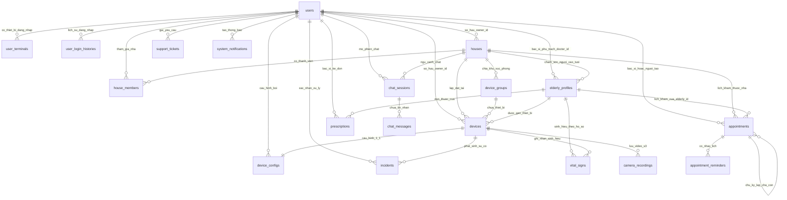

# Tài liệu Cấu trúc Cơ sở Dữ liệu — Smart Elderly Care AI (SECA)

Tài liệu này mô tả đầy đủ **22 bảng (`BASE TABLE`)** và **284 cột** đang tồn tại thực tế trong schema `public` của cơ sở dữ liệu PostgreSQL phục vụ hệ thống **Smart Elderly Care AI (SECA)** (Mobile App, Doctor Web, Web Admin, FastAPI Backend và Edge AI/BLE Gateway).

> [!NOTE]
> **Ghi chú kỹ thuật thực tế trên PostgreSQL:**
> - **Phiên bản & Extensions thực tế trên AWS RDS:** Instance AWS RDS đang vận hành **PostgreSQL 18.3 (`aarch64`)** với 3 extensions đã kích hoạt: `plpgsql (1.0)`, `uuid-ossp (1.1)`, `pgcrypto (1.4)` (môi trường Docker local sử dụng image `timescale/timescaledb:latest-pg16`).
> - Toàn bộ khóa chính đa phần sử dụng kiểu `uuid` (sinh ngẫu nhiên qua `uuid.uuid4` ở tầng ứng dụng hoặc `gen_random_uuid()` ở tầng DB), riêng `security_policies` dùng mã chuỗi `varchar(50)` và `vital_signs` dùng khóa chính kép `(id, time)`.
> - Các cột thời gian đều dùng `timestamp with time zone` (`TIMESTAMPTZ`) để lưu chuẩn UTC và chuyển đổi múi giờ Việt Nam (`UTC+7`) khi hiển thị.
> - Bảng `vital_signs` được thiết kế tương thích TimescaleDB Hypertable (khóa chính `(id, time)` + index `DESC` trên `time`); trên AWS RDS PostgreSQL 18.3 hiện tại chưa kích hoạt extension `timescaledb`, bảng hoạt động như bảng PostgreSQL tiêu chuẩn với các B-Tree index tối ưu truy vấn chuỗi thời gian.

---

## Mục lục Nhanh (22 Bảng theo Phân hệ)

| STT | Tên bảng | Phân hệ | Số cột | Khóa chính (PK) | Vai trò chính |
|---:|---|---|---:|---|---|
| 1 | `users` | Tài khoản & Bảo mật | 28 | `id` | Tài khoản người dùng toàn hệ thống (Owner, Caregiver, Member, Doctor, Admin) |
| 2 | `user_terminals` | Tài khoản & Bảo mật | 11 | `id` | Thiết bị đầu cuối (điện thoại, trình duyệt) đang giữ phiên hoạt động |
| 3 | `user_login_histories` | Tài khoản & Bảo mật | 9 | `id` | Nhật ký lịch sử các lần đăng nhập thành công / thất bại |
| 4 | `houses` | Gia đình & Người cao tuổi | 7 | `id` | Hộ gia đình / căn nhà lắp đặt hệ thống IoT chăm sóc |
| 5 | `house_members` | Gia đình & Người cao tuổi | 12 | `id` | Liên kết thành viên (người thân, bác sĩ) với nhà và phân quyền RBAC chi tiết |
| 6 | `elderly_profiles` | Gia đình & Người cao tuổi | 19 | `id` | Hồ sơ y tế & nhận diện khuôn mặt của người cao tuổi |
| 7 | `device_groups` | Thiết bị IoT | 9 | `id` | Nhóm khu vực / phòng trong nhà (Phòng khách, Phòng ngủ...) |
| 8 | `devices` | Thiết bị IoT | 19 | `id` | Danh mục thiết bị phần cứng (Camera AI, Smartband BLE, Edge Hub) |
| 9 | `device_configs` | Thiết bị IoT | 21 | `device_id` | Cấu hình chi tiết 1-1 (RTSP, chế độ riêng tư, ngưỡng cảnh báo y tế) |
| 10 | `vital_signs` | Sinh hiệu & Cảnh báo | 12 | `id, time` | Chuỗi thời gian sinh hiệu (nhịp tim, SpO2, huyết áp, nhiệt độ da, té ngã) |
| 11 | `incidents` | Sinh hiệu & Cảnh báo | 14 | `id` | Sự kiện cảnh báo khẩn cấp (té ngã AI, bất thường sinh hiệu, SOS) |
| 12 | `camera_recordings` | Sinh hiệu & Cảnh báo | 8 | `id` | Metadata các đoạn video/ảnh lưu trên S3 phục vụ phát lại & bằng chứng sự cố |
| 13 | `appointments` | Y tế Lâm sàng | 22 | `id` | Lịch khám, tái khám và nhắc lịch định kỳ của bác sĩ với bệnh nhân |
| 14 | `appointment_reminders` | Y tế Lâm sàng | 7 | `id` | Hàng đợi mốc nhắc nhở tự động trước giờ khám (24h, 2h) |
| 15 | `prescriptions` | Y tế Lâm sàng | 18 | `id` | Đơn thuốc điều trị và khung giờ nhắc uống thuốc qua loa/app |
| 16 | `chat_sessions` | Trợ lý AI & Hỗ trợ | 8 | `id` | Phiên hội thoại với Trợ lý ảo AI Sức khỏe |
| 17 | `chat_messages` | Trợ lý AI & Hỗ trợ | 6 | `id` | Từng tin nhắn hỏi/đáp trong mỗi phiên chat AI |
| 18 | `support_tickets` | Trợ lý AI & Hỗ trợ | 10 | `id` | Phiếu yêu cầu hỗ trợ kỹ thuật CSKH 24/7 |
| 19 | `system_notifications` | Quản trị Hệ thống | 16 | `id` | Thông báo toàn hệ thống do Admin tạo, lên lịch hoặc thu hồi |
| 20 | `security_policies` | Quản trị Hệ thống | 7 | `id` | Các chính sách bảo mật (2FA, mật khẩu, JWT timeout, brute-force, IP whitelist) |
| 21 | `audit_logs` | Quản trị Hệ thống | 14 | `id` | Nhật ký kiểm toán hành động quản trị & sự kiện bảo mật (append-only) |
| 22 | `system_incidents` | Quản trị Hệ thống | 7 | `id` | Nhật ký sự cố kỹ thuật nội bộ các service vận hành server |

---

## Sơ đồ Quan hệ Thực thể Tổng thể (ERD)

---

## I. Phân hệ Tài khoản, Phiên đăng nhập & Thiết bị đầu cuối

### 1. Bảng `users` (28 cột)
- **Mục đích:** Lưu thông tin định danh, xác thực, vai trò phân quyền, tùy chọn cá nhân hóa giao diện/cảnh báo, thông tin hành nghề bác sĩ và trạng thái khóa tài khoản.
- **Khóa chính:** `id`
- **Chỉ mục (Indexes):** `pk_users` (`id`), `ix_users_phone` (`UNIQUE` trên `phone`).
- **Ghi chú:** Cột `locked_by` lưu UUID quản trị viên thực hiện khóa (khai báo FK tự tham chiếu `users.id` ở ORM, trên PostgreSQL hiện tại là cột UUID thuần không ràng buộc FK cứng).

| # | Tên cột | Kiểu dữ liệu | Null | Mặc định / Ràng buộc | Giải thích ý nghĩa |
|---:|---|---|---|---|---|
| 1 | `id` | `uuid` | NOT NULL | `PK` | Mã định danh duy nhất của người dùng |
| 2 | `full_name` | `varchar(255)` | NOT NULL | — | Họ và tên đầy đủ hiển thị trên app/web |
| 3 | `hashed_password` | `varchar(255)` | NOT NULL | — | Mật khẩu đã mã hóa (bcrypt hash) |
| 4 | `phone` | `varchar(20)` | NULL | `UNIQUE INDEX` (`ix_users_phone`) | Số điện thoại đăng nhập và nhận OTP |
| 5 | `avatar_url` | `text` | NULL | — | Đường dẫn ảnh đại diện người dùng |
| 6 | `role` | `varchar(20)` | NOT NULL | — | Vai trò hệ thống: `owner`, `member`, `caregiver`, `doctor`, `admin` (hoặc `user` legacy) |
| 7 | `preferred_language` | `varchar(5)` | NOT NULL | `DEFAULT 'vi'` | Ngôn ngữ giao diện ưu tiên (`vi`, `en`) |
| 8 | `font_size_mode` | `varchar(20)` | NOT NULL | `DEFAULT 'system'` | Chế độ cỡ chữ trên mobile (`system` theo máy hoặc `custom` tùy chỉnh) |
| 9 | `custom_font_scale` | `integer` | NOT NULL | `DEFAULT 2` | Mức phóng đại cỡ chữ cho người cao tuổi (`0` đến `4`, mặc định `2`) |
| 10 | `vibration_enabled` | `boolean` | NOT NULL | `DEFAULT true` | Bật/tắt rung phản hồi và rung khi có cảnh báo trên mobile |
| 11 | `notifications_enabled` | `boolean` | NOT NULL | `DEFAULT true` | Bật/tắt nhận thông báo đẩy chung |
| 12 | `alert_sound_enabled` | `boolean` | NOT NULL | `DEFAULT true` | Bật/tắt âm thanh thông báo cảnh báo thường |
| 13 | `critical_alert_enabled` | `boolean` | NOT NULL | `DEFAULT true` | Bật/tắt âm thanh báo động khẩn cấp mức nghiêm trọng (SOS/té ngã) |
| 14 | `cchn_number` | `varchar(50)` | NULL | — | Số Chứng chỉ hành nghề y (dành cho tài khoản `doctor`) |
| 15 | `specialty` | `varchar(255)` | NULL | — | Chuyên khoa của bác sĩ (vd: Lão khoa, Tim mạch) |
| 16 | `workplace` | `varchar(255)` | NULL | — | Đơn vị công tác / bệnh viện của bác sĩ |
| 17 | `is_active` | `boolean` | NOT NULL | — | Cờ kích hoạt tài khoản (`true`: hoạt động, `false`: vô hiệu hóa) |
| 18 | `fcm_token` | `varchar(500)` | NULL | — | Token Firebase Cloud Messaging để gửi push notification tới thiết bị |
| 19 | `created_at` | `timestamp with time zone` | NOT NULL | `DEFAULT now()` | Thời điểm tạo tài khoản |
| 20 | `updated_at` | `timestamp with time zone` | NOT NULL | `DEFAULT now()` | Thời điểm cập nhật thông tin gần nhất |
| 21 | `last_login_at` | `timestamp with time zone` | NULL | — | Thời điểm đăng nhập gần nhất (phục vụ đánh giá tài khoản không hoạt động) |
| 22 | `two_factor_enabled` | `boolean` | NULL | `DEFAULT false` | Bật/tắt xác thực 2 bước (2FA / OTP) cho tài khoản |
| 23 | `status` | `varchar(30)` | NULL | `DEFAULT 'active'` | Trạng thái chi tiết tài khoản: `active`, `locked_auto` (khóa do brute-force), `locked_admin` (admin khóa) |
| 24 | `lock_reason` | `text` | NULL | — | Lý do khóa tài khoản bắt buộc khi admin khóa |
| 25 | `locked_at` | `timestamp with time zone` | NULL | — | Thời điểm tài khoản bị khóa |
| 26 | `locked_by` | `uuid` | NULL | — | UUID của admin đã thực hiện khóa tài khoản |
| 27 | `lock_until` | `timestamp with time zone` | NULL | — | Mốc thời gian tự động mở khóa nếu là khóa tạm thời |
| 28 | `token_version` | `integer` | NULL | `DEFAULT 1` | Phiên bản JWT token; tăng giá trị để thu hồi toàn bộ token cũ của user |

---

### 2. Bảng `user_terminals` (11 cột)
- **Mục đích:** Quản lý danh sách thiết bị đầu cuối (điện thoại, tablet, trình duyệt web) đang đăng nhập và giữ phiên làm việc của người dùng.
- **Khóa chính:** `id`
- **Khóa ngoại:** `user_id -> users.id (ON DELETE CASCADE)`
- **Chỉ mục:** `pk_user_terminals` (`id`), `ix_user_terminals_user_id` (`user_id`), `ix_user_terminals_last_active` (`last_active_at DESC`).

| # | Tên cột | Kiểu dữ liệu | Null | Mặc định / Ràng buộc | Giải thích ý nghĩa |
|---:|---|---|---|---|---|
| 1 | `id` | `uuid` | NOT NULL | `PK` | Mã định danh duy nhất của phiên/thiết bị đầu cuối |
| 2 | `user_id` | `uuid` | NOT NULL | `FK -> users.id (ON DELETE CASCADE)` | Chủ sở hữu phiên đăng nhập |
| 3 | `device_name` | `varchar(255)` | NOT NULL | — | Tên hiển thị thiết bị (vd: `iPhone 15`, `Microsoft Edge (Windows 11)`) |
| 4 | `device_type` | `varchar(50)` | NOT NULL | — | Loại client: `mobile`, `tablet`, `desktop`, `web` |
| 5 | `os` | `varchar(100)` | NULL | — | Hệ điều hành của client (vd: `iOS`, `Android`, `Windows 11`) |
| 6 | `browser` | `varchar(100)` | NULL | — | Tên trình duyệt nếu đăng nhập qua Web (vd: `Chrome`, `Microsoft Edge`) |
| 7 | `ip_address` | `varchar(50)` | NOT NULL | — | Địa chỉ IP gần nhất của phiên đầu cuối |
| 8 | `location` | `varchar(255)` | NULL | — | Vị trí địa lý ước lượng theo IP (vd: `Đà Nẵng, Việt Nam`) |
| 9 | `last_active_at` | `timestamp with time zone` | NOT NULL | `DEFAULT now()` | Lần tương tác API gần nhất; dùng tính trạng thái `active`/`warning`/`expired` |
| 10 | `is_active` | `boolean` | NOT NULL | `DEFAULT true` | `true`: phiên còn hiệu lực; `false`: đã đăng xuất hoặc bị thu hồi từ xa |
| 11 | `created_at` | `timestamp with time zone` | NOT NULL | `DEFAULT now()` | Thời điểm phiên/thiết bị này đăng nhập lần đầu |

---

### 3. Bảng `user_login_histories` (9 cột)
- **Mục đích:** Lưu lịch sử chi tiết từng lần đăng nhập (thành công hoặc thất bại) để phục vụ kiểm tra bảo mật và phát hiện truy cập bất thường.
- **Khóa chính:** `id`
- **Khóa ngoại:** `user_id -> users.id (ON DELETE CASCADE)`
- **Chỉ mục:** `pk_user_login_histories` (`id`), `ix_user_login_histories_user_id` (`user_id`), `ix_user_login_histories_login_time` (`login_time`).

| # | Tên cột | Kiểu dữ liệu | Null | Mặc định / Ràng buộc | Giải thích ý nghĩa |
|---:|---|---|---|---|---|
| 1 | `id` | `uuid` | NOT NULL | `PK` | Mã bản ghi lịch sử đăng nhập |
| 2 | `user_id` | `uuid` | NOT NULL | `FK -> users.id (ON DELETE CASCADE)` | Người dùng thực hiện đăng nhập |
| 3 | `device_name` | `varchar(255)` | NOT NULL | — | Tên thiết bị thực hiện đăng nhập |
| 4 | `ip_address` | `varchar(50)` | NOT NULL | — | Địa chỉ IP của lần đăng nhập |
| 5 | `location` | `varchar(255)` | NULL | — | Vị trí địa lý ước lượng (vd: `Đà Nẵng, Việt Nam`) |
| 6 | `login_time` | `timestamp with time zone` | NOT NULL | `DEFAULT now()` | Thời điểm phát sinh lượt đăng nhập |
| 7 | `login_method` | `varchar(50)` | NOT NULL | — | Phương thức xác thực: `Mật khẩu`, `SMS OTP`, `Biometric` |
| 8 | `status` | `varchar(20)` | NOT NULL | — | Kết quả đăng nhập: `success` hoặc `failed` |
| 9 | `user_agent` | `varchar(500)` | NULL | — | Chuỗi User-Agent gốc từ trình duyệt hoặc ứng dụng di động |

---

## II. Phân hệ Gia đình, Phân quyền & Hồ sơ Người cao tuổi

### 4. Bảng `houses` (7 cột)
- **Mục đích:** Đại diện cho một căn nhà / hộ gia đình triển khai thiết bị IoT (Camera, Edge Hub, Smartband) và quản lý người cao tuổi.
- **Khóa chính:** `id`
- **Khóa ngoại:** `owner_id -> users.id (ON DELETE RESTRICT)` (không cho xóa user nếu vẫn đang đứng tên chủ sở hữu nhà).
- **Chỉ mục:** `pk_houses` (`id`).

| # | Tên cột | Kiểu dữ liệu | Null | Mặc định / Ràng buộc | Giải thích ý nghĩa |
|---:|---|---|---|---|---|
| 1 | `id` | `uuid` | NOT NULL | `PK` | Mã định danh duy nhất của căn nhà |
| 2 | `name` | `varchar(150)` | NOT NULL | — | Tên gợi nhớ căn nhà (mặc định: `Nhà của tôi`) |
| 3 | `address` | `varchar(300)` | NULL | — | Địa chỉ thực tế nơi lắp đặt hệ thống (hỗ trợ cấp cứu khi có SOS) |
| 4 | `current_mode` | `varchar(20)` | NOT NULL | — | Chế độ an ninh nhà hiện tại: `HOME`, `AWAY`, `DISARM`, `ALARM`, `PRIVACY` |
| 5 | `owner_id` | `uuid` | NOT NULL | `FK -> users.id (ON DELETE RESTRICT)` | Người dùng là chủ sở hữu chính của căn nhà |
| 6 | `created_at` | `timestamp with time zone` | NOT NULL | `DEFAULT now()` | Thời điểm tạo căn nhà |
| 7 | `updated_at` | `timestamp with time zone` | NOT NULL | `DEFAULT now()` | Thời điểm cập nhật cấu hình nhà gần nhất |

---

### 5. Bảng `house_members` (12 cột)
- **Mục đích:** Bảng trung gian gắn người dùng (Chủ nhà, Người chăm sóc, Bác sĩ, Người thân) vào căn nhà kèm ma trận phân quyền chi tiết (RBAC).
- **Khóa chính:** `id`
- **Khóa ngoại:** `house_id -> houses.id (ON DELETE CASCADE)`, `user_id -> users.id (ON DELETE CASCADE)`.
- **Ràng buộc duy nhất & Chỉ mục:** `uq_house_member` (`UNIQUE (house_id, user_id)`), `ix_house_members_house_id`, `ix_house_members_user_id`.

| # | Tên cột | Kiểu dữ liệu | Null | Mặc định / Ràng buộc | Giải thích ý nghĩa |
|---:|---|---|---|---|---|
| 1 | `id` | `uuid` | NOT NULL | `PK` | Mã định danh bản ghi thành viên |
| 2 | `house_id` | `uuid` | NOT NULL | `FK -> houses.id (ON DELETE CASCADE)`, `UQ (house_id, user_id)` | Căn nhà mà thành viên được cấp quyền truy cập |
| 3 | `user_id` | `uuid` | NOT NULL | `FK -> users.id (ON DELETE CASCADE)`, `UQ (house_id, user_id)` | Tài khoản người dùng tham gia nhà |
| 4 | `role_in_house` | `varchar(50)` | NOT NULL | — | Vai trò trong hộ gia đình: `OWNER`, `MEMBER`, `CAREGIVER`, `DOCTOR`, `RELATIVE` |
| 5 | `permissions` | `varchar(50)` | NOT NULL | — | Nhóm quyền tổng quát: `ADMIN`, `EDIT`, `VIEW`, `OPERATOR` |
| 6 | `can_view_health` | `boolean` | NOT NULL | `DEFAULT true` | Quyền xem chỉ số sinh hiệu và lịch sử sức khỏe |
| 7 | `can_view_camera` | `boolean` | NOT NULL | `DEFAULT true` | Quyền xem luồng camera trực tiếp và video lưu trữ |
| 8 | `can_handle_emergency` | `boolean` | NOT NULL | `DEFAULT true` | Quyền nhận cảnh báo SOS/té ngã và xác nhận xử lý sự cố |
| 9 | `can_manage_devices` | `boolean` | NOT NULL | `DEFAULT false` | Quyền thêm/sửa/cấu hình ngưỡng thiết bị IoT |
| 10 | `can_manage_records` | `boolean` | NOT NULL | `DEFAULT false` | Quyền chỉnh sửa hồ sơ bệnh án của người cao tuổi |
| 11 | `joined_at` | `timestamp with time zone` | NOT NULL | `DEFAULT now()` | Thời điểm thành viên tham gia vào căn nhà |
| 12 | `status` | `varchar(30)` | NOT NULL | `DEFAULT 'ACTIVE'` | Trạng thái thành viên trong nhà (vd: `ACTIVE`, `PENDING`, `REVOKED`) |

---

### 6. Bảng `elderly_profiles` (19 cột)
- **Mục đích:** Lưu hồ sơ nhân trắc học, tiền sử bệnh lý, dị ứng, chế độ dinh dưỡng, bác sĩ phụ trách và vector nhận diện khuôn mặt của từng người cao tuổi.
- **Khóa chính:** `id`
- **Khóa ngoại:** `house_id -> houses.id (ON DELETE CASCADE)`, `doctor_id -> users.id (ON DELETE SET NULL)`.
- **Chỉ mục:** `pk_elderly_profiles` (`id`), `ix_elderly_profiles_house_id`, `ix_elderly_profiles_doctor_id`.

| # | Tên cột | Kiểu dữ liệu | Null | Mặc định / Ràng buộc | Giải thích ý nghĩa |
|---:|---|---|---|---|---|
| 1 | `id` | `uuid` | NOT NULL | `PK` | Mã định danh duy nhất hồ sơ người cao tuổi (còn được tham chiếu là `patient_id`) |
| 2 | `house_id` | `uuid` | NOT NULL | `FK -> houses.id (ON DELETE CASCADE)` | Căn nhà nơi người cao tuổi sinh sống |
| 3 | `full_name` | `varchar(150)` | NOT NULL | — | Họ và tên người cao tuổi |
| 4 | `birth_year` | `integer` | NULL | — | Năm sinh (vd: `1948`) dùng tính tuổi lâm sàng |
| 5 | `gender` | `varchar(20)` | NULL | — | Giới tính (`MALE`, `FEMALE`, `OTHER`) |
| 6 | `medical_history` | `text` | NULL | — | Mô tả tự do tiền sử bệnh lý mạn tính (tăng huyết áp, tim mạch, tiểu đường...) |
| 7 | `conditions_json` | `text` | NULL | — | Chuỗi JSON lưu danh sách bệnh nền có cấu trúc |
| 8 | `blood_type` | `varchar(10)` | NULL | — | Nhóm máu hệ ABO/Rh (vd: `A+`, `O+`, `AB-`) |
| 9 | `height_cm` | `integer` | NULL | — | Chiều cao (cm), dùng để tính chỉ số BMI chuẩn WPRO |
| 10 | `weight_kg` | `integer` | NULL | — | Cân nặng (kg), dùng để tính chỉ số BMI |
| 11 | `drug_allergies` | `text` | NULL | — | Danh sách thuốc gây dị ứng / chống chỉ định (cảnh báo khi kê đơn) |
| 12 | `food_allergies` | `text` | NULL | — | Thực phẩm cần kiêng do dị ứng |
| 13 | `dietary_notes` | `text` | NULL | — | Lưu ý chế độ dinh dưỡng (vd: ăn nhạt, giảm đường) |
| 14 | `emergency_contact_phone` | `varchar(20)` | NULL | — | Số điện thoại người thân ưu tiên liên hệ khi khẩn cấp |
| 15 | `avatar_url` | `varchar(500)` | NULL | — | Đường dẫn ảnh chân dung người cao tuổi |
| 16 | `face_embedding` | `text` | NULL | — | Chuỗi JSON vector đặc trưng khuôn mặt 128 chiều phục vụ AI Camera nhận diện |
| 17 | `created_at` | `timestamp with time zone` | NOT NULL | `DEFAULT now()` | Thời điểm tạo hồ sơ |
| 18 | `updated_at` | `timestamp with time zone` | NOT NULL | `DEFAULT now()` | Thời điểm cập nhật hồ sơ gần nhất |
| 19 | `doctor_id` | `uuid` | NULL | `FK -> users.id (ON DELETE SET NULL)` | Bác sĩ gia đình trực tiếp theo dõi người cao tuổi này |

---

## III. Phân hệ Thiết bị IoT & Cấu hình Ngưỡng y tế

### 7. Bảng `device_groups` (9 cột)
- **Mục đích:** Nhóm phân khu/phòng trong nhà (Phòng khách, Phòng ngủ, Ban công...) để gom nhóm hiển thị và điều phối thiết bị trên app.
- **Khóa chính:** `id`
- **Khóa ngoại:** `house_id -> houses.id (ON DELETE CASCADE)`
- **Ràng buộc duy nhất & Chỉ mục:** `uq_device_group_house_name` (`UNIQUE (house_id, name)`), `ix_device_groups_house_id`.

| # | Tên cột | Kiểu dữ liệu | Null | Mặc định / Ràng buộc | Giải thích ý nghĩa |
|---:|---|---|---|---|---|
| 1 | `id` | `uuid` | NOT NULL | `PK` | Mã định danh nhóm khu vực/phòng |
| 2 | `house_id` | `uuid` | NOT NULL | `FK -> houses.id (ON DELETE CASCADE)`, `UQ (house_id, name)` | Căn nhà chứa nhóm phòng này |
| 3 | `name` | `varchar(100)` | NOT NULL | `UQ (house_id, name)` | Tên phòng/nhóm (duy nhất trong cùng một nhà, vd: `Phòng khách`) |
| 4 | `description` | `varchar(255)` | NULL | — | Mô tả bổ sung về vị trí/khu vực |
| 5 | `icon` | `varchar(50)` | NOT NULL | — | Tên icon hiển thị trên giao diện mobile (mặc định ORM: `folder`) |
| 6 | `color` | `varchar(20)` | NOT NULL | — | Mã màu hex đại diện trên UI (mặc định ORM: `#7C3AED`) |
| 7 | `sort_order` | `integer` | NOT NULL | — | Thứ tự sắp xếp hiển thị các nhóm phòng |
| 8 | `created_at` | `timestamp with time zone` | NOT NULL | `DEFAULT now()` | Thời điểm tạo nhóm |
| 9 | `updated_at` | `timestamp with time zone` | NOT NULL | `DEFAULT now()` | Thời điểm cập nhật nhóm |

---

### 8. Bảng `devices` (19 cột)
- **Mục đích:** Bảng Master quản lý toàn bộ thiết bị phần cứng IoT: Camera AI, Vòng đeo tay thông minh BLE (`SMARTBAND`), và Thiết bị trung tâm (`EDGE_HUB`).
- **Khóa chính:** `id`
- **Khóa ngoại:** `owner_id -> users.id (CASCADE)`, `house_id -> houses.id (CASCADE)`, `group_id -> device_groups.id (SET NULL)`, `elderly_id -> elderly_profiles.id (SET NULL)`.
- **Chỉ mục:** `pk_devices` (`id`), `ix_devices_device_id` (`UNIQUE` trên `device_id`), và các index trên `device_type`, `elderly_id`, `group_id`, `house_id`, `last_heartbeat`, `owner_id`.

| # | Tên cột | Kiểu dữ liệu | Null | Mặc định / Ràng buộc | Giải thích ý nghĩa |
|---:|---|---|---|---|---|
| 1 | `id` | `uuid` | NOT NULL | `PK` | Khóa chính nội bộ dạng UUID của thiết bị |
| 2 | `device_id` | `varchar(100)` | NOT NULL | `UNIQUE INDEX` (`ix_devices_device_id`) | Mã phần cứng định danh duy nhất trên toàn hệ thống (vd: `SECA_001`, `BLE_BAND_001`) |
| 3 | `name` | `varchar(150)` | NOT NULL | — | Tên hiển thị của thiết bị |
| 4 | `sub_title` | `varchar(255)` | NULL | — | Phụ đề mô tả model/thông số ngắn gọn |
| 5 | `device_type` | `varchar(30)` | NOT NULL | — | Loại phần cứng: `CAMERA`, `SMARTBAND`, `EDGE_HUB` |
| 6 | `location` | `varchar(255)` | NULL | — | Tên vị trí lắp đặt dạng văn bản |
| 7 | `is_online` | `boolean` | NOT NULL | — | Trạng thái kết nối trực tuyến thực tế (`true`/`false`) |
| 8 | `status_text` | `varchar(150)` | NULL | — | Dòng mô tả trạng thái hiển thị trên app (vd: `Đang ghi hình`, `Đang đeo`) |
| 9 | `battery_level` | `smallint` | NULL | — | Phần trăm pin (`0`–`100`) cho Smartband; `NULL` với thiết bị cắm điện |
| 10 | `mac_address` | `varchar(50)` | NULL | — | Địa chỉ MAC (đặc biệt quan trọng cho vòng tay BLE Xiaomi Band) |
| 11 | `ip_address` | `varchar(45)` | NULL | — | Địa chỉ IPv4/IPv6 nội bộ của Camera hoặc Edge Hub |
| 12 | `firmware_version` | `varchar(50)` | NULL | — | Phiên bản firmware đang chạy trên thiết bị |
| 13 | `last_heartbeat` | `timestamp with time zone` | NULL | — | Mốc thời gian nhận gói tin heartbeat/giữ kết nối cuối cùng |
| 14 | `owner_id` | `uuid` | NOT NULL | `FK -> users.id (ON DELETE CASCADE)` | Chủ sở hữu đăng ký thiết bị |
| 15 | `house_id` | `uuid` | NULL | `FK -> houses.id (ON DELETE CASCADE)` | Căn nhà nơi thiết bị hoạt động |
| 16 | `group_id` | `uuid` | NULL | `FK -> device_groups.id (ON DELETE SET NULL)` | Nhóm khu vực/phòng chứa thiết bị |
| 17 | `elderly_id` | `uuid` | NULL | `FK -> elderly_profiles.id (ON DELETE SET NULL)` | Người cao tuổi đang gắn theo dõi (chủ yếu cho Smartband) |
| 18 | `created_at` | `timestamp with time zone` | NOT NULL | `DEFAULT now()` | Thời điểm ghép nối/thêm thiết bị |
| 19 | `updated_at` | `timestamp with time zone` | NOT NULL | `DEFAULT now()` | Thời điểm cập nhật thông tin thiết bị gần nhất |

---

### 9. Bảng `device_configs` (21 cột)
- **Mục đích:** Lưu cấu hình chuyên sâu theo quan hệ **1–1** với `devices` (cấu hình luồng Camera AI, chế độ riêng tư và ngưỡng cảnh báo y tế cá nhân hóa cho Smartband/Edge Hub).
- **Khóa chính & Khóa ngoại 1–1:** `device_id -> devices.id (ON DELETE CASCADE)`
- **Khóa ngoại phụ:** `configured_by_user_id -> users.id (ON DELETE SET NULL)`
- **Chỉ mục:** `pk_device_configs` (`device_id`), `ix_device_configs_configured_by_user_id`.

| # | Tên cột | Kiểu dữ liệu | Null | Mặc định / Ràng buộc | Giải thích ý nghĩa |
|---:|---|---|---|---|---|
| 1 | `device_id` | `uuid` | NOT NULL | `PK`, `FK -> devices.id (ON DELETE CASCADE)` | Khóa chính kiêm khóa ngoại 1–1 trỏ tới thiết bị |
| 2 | `stream_url` | `varchar(500)` | NULL | — | Đường dẫn RTSP/HLS/WebRTC của camera |
| 3 | `resolution` | `varchar(20)` | NOT NULL | — | Độ phân giải video cấu hình: `2K`, `FHD`, `SD` |
| 4 | `is_sleep` | `boolean` | NOT NULL | — | Chế độ ngủ bảo vệ riêng tư (tạm dừng giám sát/hiển thị camera) |
| 5 | `is_ai_protect` | `boolean` | NOT NULL | — | Bật/tắt thuật toán AI nhận diện té ngã (YOLOv8-Pose) |
| 6 | `has_two_way_audio` | `boolean` | NOT NULL | — | Cờ hỗ trợ/kích hoạt đàm thoại âm thanh 2 chiều |
| 7 | `hr_threshold_high` | `integer` | NOT NULL | — | Ngưỡng nhịp tim cao kích hoạt cảnh báo (bpm, mặc định `120`) |
| 8 | `hr_threshold_low` | `integer` | NOT NULL | — | Ngưỡng nhịp tim thấp kích hoạt cảnh báo (bpm, mặc định `50`) |
| 9 | `spo2_threshold_low` | `integer` | NOT NULL | — | Ngưỡng oxy máu SpO2 tối thiểu an toàn (%, mặc định `90`) |
| 10 | `bp_systolic_high` | `integer` | NOT NULL | — | Ngưỡng huyết áp tâm thu cao (mmHg, mặc định `140`) |
| 11 | `bp_systolic_low` | `integer` | NOT NULL | — | Ngưỡng huyết áp tâm thu thấp (mmHg, mặc định `90`) |
| 12 | `bp_diastolic_high` | `integer` | NOT NULL | — | Ngưỡng huyết áp tâm trương cao (mmHg, mặc định `90`) |
| 13 | `bp_diastolic_low` | `integer` | NOT NULL | — | Ngưỡng huyết áp tâm trương thấp (mmHg, mặc định `60`) |
| 14 | `fall_impact_threshold` | `double precision` | NOT NULL | — | Ngưỡng gia tốc va đập phát hiện ngã (đơn vị `g`, mặc định `2.5`) |
| 15 | `immobility_seconds` | `integer` | NOT NULL | — | Thời gian bất động sau cú ngã để xác nhận báo động (giây, mặc định `30`) |
| 16 | `mqtt_topic` | `varchar(150)` | NULL | — | Topic MQTT giao tiếp riêng của thiết bị / Edge Hub |
| 17 | `is_custom_thresholds` | `boolean` | NOT NULL | — | `true`: đã cá nhân hóa ngưỡng riêng; `false`: đang dùng ngưỡng y tế mặc định |
| 18 | `configured_by_user_id` | `uuid` | NULL | `FK -> users.id (ON DELETE SET NULL)` | ID bác sĩ hoặc chủ nhà thực hiện thay đổi cấu hình gần nhất |
| 19 | `configured_by_role` | `varchar(20)` | NULL | — | Vai trò người cấu hình: `OWNER`, `DOCTOR`, `SYSTEM` |
| 20 | `extra_settings` | `jsonb` | NULL | — | Trường JSONB mở rộng lưu thêm tham số tùy chỉnh thiết bị |
| 21 | `updated_at` | `timestamp with time zone` | NOT NULL | `DEFAULT now()` | Thời điểm cập nhật cấu hình gần nhất |

---

## IV. Phân hệ Sinh hiệu, Cảnh báo Sự cố & Lưu trữ Camera

### 10. Bảng `vital_signs` (12 cột)
- **Mục đích:** Lưu chuỗi dữ liệu sinh hiệu thời gian thực đo từ vòng đeo tay thông minh (Smartband) và trạng thái phát hiện người/té ngã từ Edge AI.
- **Khóa chính kép:** `(id, time)`
- **Khóa ngoại:** `device_id -> devices.id (ON DELETE CASCADE)`, `elderly_id -> elderly_profiles.id (ON DELETE CASCADE)`.
- **Chỉ mục:** `pk_vital_signs`, `ix_vital_signs_device_id`, `ix_vital_signs_elderly_id`, `ix_vital_signs_time`, `ix_vital_signs_time_desc`, `ix_vital_signs_device_time_desc`, `ix_vital_signs_recorded_at_desc`.

| # | Tên cột | Kiểu dữ liệu | Null | Mặc định / Ràng buộc | Giải thích ý nghĩa |
|---:|---|---|---|---|---|
| 1 | `id` | `uuid` | NOT NULL | `PK` (ghép với `time`) | Mã bản ghi đo sinh hiệu |
| 2 | `time` | `timestamp with time zone` | NOT NULL | `PK`, `DEFAULT now()` | Mốc thời gian ghi nhận bản ghi (trục thời gian chính/phân vùng) |
| 3 | `device_id` | `uuid` | NOT NULL | `FK -> devices.id (ON DELETE CASCADE)` | Thiết bị gửi dữ liệu sinh hiệu |
| 4 | `heart_rate` | `integer` | NULL | — | Nhịp tim đo được (nhịp/phút — bpm) |
| 5 | `spo2` | `integer` | NULL | — | Nồng độ bão hòa oxy trong máu SpO2 (`%`) |
| 6 | `bp_systolic` | `integer` | NULL | — | Huyết áp tâm thu (mmHg, `NULL` nếu thiết bị không đo huyết áp) |
| 7 | `bp_diastolic` | `integer` | NULL | — | Huyết áp tâm trương (mmHg, `NULL` nếu thiết bị không đo huyết áp) |
| 8 | `skin_temp_max` | `double precision` | NULL | — | Nhiệt độ da tối đa ghi nhận (`°C`, có thể `NULL` tùy cảm biến) |
| 9 | `person_count` | `integer` | NULL | — | Số người phát hiện trong khung hình camera (nếu gửi kèm từ Edge AI) |
| 10 | `fall_detected` | `boolean` | NULL | — | Cờ ghi nhận phát hiện té ngã tại mốc đo này |
| 11 | `elderly_id` | `uuid` | NULL | `FK -> elderly_profiles.id (ON DELETE CASCADE)` | Liên kết trực tiếp tới hồ sơ người cao tuổi (bổ sung qua schema upgrade) |
| 12 | `recorded_at` | `timestamp with time zone` | NULL | `DEFAULT CURRENT_TIMESTAMP` | Thời điểm đo thực tế từ thiết bị/hệ thống (phục vụ sắp xếp bổ sung) |

---

### 11. Bảng `incidents` (14 cột)
- **Mục đích:** Lưu các sự cố/cảnh báo khẩn cấp phát sinh từ AI Camera, Vòng đeo tay bất thường sinh hiệu hoặc nút SOS từ ứng dụng.
- **Khóa chính:** `id`
- **Khóa ngoại:** `device_id -> devices.id (ON DELETE CASCADE)`, `acknowledged_by -> users.id (ON DELETE NO ACTION)`.
- **Chỉ mục:** `pk_incidents` (`id`), `ix_incidents_device_id`, `ix_incidents_created_at`.

| # | Tên cột | Kiểu dữ liệu | Null | Mặc định / Ràng buộc | Giải thích ý nghĩa |
|---:|---|---|---|---|---|
| 1 | `id` | `uuid` | NOT NULL | `PK` | Mã duy nhất của sự cố cảnh báo |
| 2 | `device_id` | `uuid` | NOT NULL | `FK -> devices.id (ON DELETE CASCADE)` | Thiết bị phát hiện hoặc phát sinh cảnh báo |
| 3 | `alert_type` | `varchar(50)` | NOT NULL | — | Loại cảnh báo: `FALL_DETECTED`, `AI_FALL`, `LOW_SPO2`, `HIGH_HR`, `LOW_HR`, `HIGH_BP`, `LOW_BP`, `SOS`, `DOCTOR_ALERT`... |
| 4 | `alert_level` | `varchar(20)` | NOT NULL | — | Mức độ nghiêm trọng: `LOW`, `MEDIUM`, `HIGH`, `CRITICAL` |
| 5 | `message` | `text` | NOT NULL | — | Nội dung mô tả chi tiết cảnh báo hiển thị cho người thân & bác sĩ |
| 6 | `confidence` | `double precision` | NULL | — | Độ tin cậy của mô hình AI khi phát hiện sự cố (`0.0`–`1.0`) |
| 7 | `sources` | `varchar(255)` | NULL | — | Chuỗi JSON danh sách nguồn cảm biến xác nhận sự cố (vd: `["camera", "smartband"]`) |
| 8 | `video_clip_url` | `varchar(1000)` | NULL | — | Đường dẫn phát lại đoạn video bằng chứng khi xảy ra sự cố |
| 9 | `thumbnail_url` | `varchar(1000)` | NULL | — | Đường dẫn ảnh chụp khoảnh khắc sự cố |
| 10 | `is_acknowledged` | `boolean` | NOT NULL | — | Cờ đánh dấu người thân/bác sĩ đã xác nhận tiếp nhận xử lý hay chưa |
| 11 | `acknowledged_by` | `uuid` | NULL | `FK -> users.id (ON DELETE NO ACTION)` | Người dùng đã bấm xác nhận xử lý sự cố |
| 12 | `acknowledged_at` | `timestamp with time zone` | NULL | — | Thời điểm xác nhận xử lý |
| 13 | `notes` | `text` | NULL | — | Ghi chú xử lý / phản hồi của người chăm sóc hoặc bác sĩ |
| 14 | `created_at` | `timestamp with time zone` | NOT NULL | `DEFAULT now()` | Thời điểm phát sinh cảnh báo |

---

### 12. Bảng `camera_recordings` (8 cột)
- **Mục đích:** Lưu metadata của các phân đoạn video lịch sử (`segment`) và bằng chứng sự cố (`incident`, `snapshot`) lưu trữ riêng tư trên AWS S3 (URL phát lại được ký động khi kiểm tra quyền camera hợp lệ).
- **Khóa chính:** `id`
- **Khóa ngoại:** `device_id -> devices.id (ON DELETE CASCADE)`
- **Ràng buộc duy nhất & Chỉ mục:** `uq_camera_recordings_object_key` (`UNIQUE` trên `object_key`), `ix_camera_recordings_timeline` (`(device_id, started_at, id)`), `ix_camera_recordings_incident_id`.
- **Ghi chú:** Cột `incident_id` cố ý không gắn FK cứng vì video bằng chứng từ camera có thể upload trước khi bản ghi `incidents` qua MQTT được tạo.

| # | Tên cột | Kiểu dữ liệu | Null | Mặc định / Ràng buộc | Giải thích ý nghĩa |
|---:|---|---|---|---|---|
| 1 | `id` | `uuid` | NOT NULL | `PK` | Mã duy nhất của segment/bản ghi video |
| 2 | `device_id` | `uuid` | NOT NULL | `FK -> devices.id (ON DELETE CASCADE)` | Camera đã quay đoạn video/ảnh |
| 3 | `object_key` | `varchar(255)` | NOT NULL | `UNIQUE` (`uq_camera_recordings_object_key`) | Đường dẫn key của tệp `.mp4`/`.ts`/`.jpg` trên S3 bucket |
| 4 | `kind` | `varchar(20)` | NOT NULL | — | Loại tệp lưu trữ: `segment` (video liên tục 2s), `incident` (clip sự cố), `snapshot` (ảnh chụp sự cố) |
| 5 | `started_at` | `timestamp with time zone` | NOT NULL | — | Thời điểm bắt đầu của đoạn ghi hình |
| 6 | `duration` | `double precision` | NOT NULL | — | Thời lượng đoạn video tính bằng giây (`0` đối với `snapshot`) |
| 7 | `size_bytes` | `bigint` | NOT NULL | — | Dung lượng tệp trên S3 tính bằng byte (dùng xác thực khớp metadata S3) |
| 8 | `incident_id` | `uuid` | NULL | `INDEX` (`ix_camera_recordings_incident_id`) | ID sự cố liên quan nếu `kind` là `incident` hoặc `snapshot` (`NULL` với `segment`) |

---

## V. Phân hệ Y tế Lâm sàng (Lịch khám & Đơn thuốc)

### 13. Bảng `appointments` (22 cột)
- **Mục đích:** Quản lý toàn bộ lịch hẹn khám/tái khám giữa bác sĩ và người cao tuổi, hỗ trợ lặp định kỳ theo chuỗi cha–con và nhắc qua loa thông minh.
- **Khóa chính:** `id`
- **Khóa ngoại:** `doctor_id -> users.id (SET NULL)`, `house_id -> houses.id (CASCADE)`, `created_by -> users.id (SET NULL)`, `parent_recurring_id -> appointments.id (SET NULL)`, `elderly_id -> elderly_profiles.id (CASCADE)`.
- **Chỉ mục:** 13 chỉ mục (`pk_appointments`, `ix_appointments_doctor_id`, `ix_appointments_doctor_recorded`, `ix_appointments_doctor_time`, `ix_appointments_elderly_id`, `ix_appointments_house_id`, `ix_appointments_parent_recurring_id`, `ix_appointments_patient_id`, `ix_appointments_patient_time`, `ix_appointments_recorded_at_desc`, `ix_appointments_scheduled_at`, `ix_appointments_scheduled_at_desc`, `ix_appointments_status`).

| # | Tên cột | Kiểu dữ liệu | Null | Mặc định / Ràng buộc | Giải thích ý nghĩa |
|---:|---|---|---|---|---|
| 1 | `id` | `uuid` | NOT NULL | `PK` | Mã duy nhất của lịch hẹn khám |
| 2 | `doctor_id` | `uuid` | NULL | `FK -> users.id (ON DELETE SET NULL)` | Bác sĩ phụ trách lịch khám |
| 3 | `patient_id` | `uuid` | NOT NULL | `INDEX` | UUID bệnh nhân người cao tuổi (giữ tương thích logic cũ/schema chính) |
| 4 | `house_id` | `uuid` | NULL | `FK -> houses.id (ON DELETE CASCADE)` | Căn nhà của bệnh nhân |
| 5 | `created_by` | `uuid` | NULL | `FK -> users.id (ON DELETE SET NULL)` | Người tạo/điều chỉnh gần nhất lịch hẹn (bác sĩ hoặc người thân) |
| 6 | `visit_type` | `varchar(30)` | NOT NULL | — | Hình thức khám: `CLINIC` (tại phòng khám), `HOME_VISIT` (tại nhà), `TELEHEALTH` (từ xa) |
| 7 | `scheduled_at` | `timestamp with time zone` | NOT NULL | — | Thời gian hẹn khám dự kiến |
| 8 | `duration_minutes` | `integer` | NOT NULL | — | Thời lượng dự kiến của buổi khám (phút, vd: `30`) |
| 9 | `location` | `varchar(255)` | NOT NULL | — | Địa điểm khám cụ thể hoặc tên phòng khám |
| 10 | `clinical_notes` | `text` | NULL | — | Dặn dò chuẩn bị trước khám, lý do dời lịch hoặc ghi chú lâm sàng |
| 11 | `status` | `varchar(20)` | NOT NULL | — | Trạng thái lịch hẹn: `UPCOMING` (sắp tới), `CONFIRMED` (đã xác nhận), `COMPLETED` (hoàn thành), `CANCELLED` (đã hủy) |
| 12 | `cancellation_reason` | `text` | NULL | — | Lý do hủy lịch khám (nếu `status = 'CANCELLED'`) |
| 13 | `recurrence_pattern` | `varchar(20)` | NOT NULL | — | Chu kỳ lặp lại: `NONE`, `WEEKLY`, `MONTHLY`, `QUARTERLY` |
| 14 | `recurrence_end_date` | `timestamp with time zone` | NULL | — | Ngày kết thúc chuỗi lịch hẹn lặp lại |
| 15 | `parent_recurring_id` | `uuid` | NULL | `FK -> appointments.id (ON DELETE SET NULL)` | Trỏ về lịch khám gốc nếu đây là một lần lặp sinh tự động |
| 16 | `enable_speaker_reminder` | `boolean` | NOT NULL | — | Bật/tắt phát giọng nói nhắc lịch khám trên loa thông minh tại nhà |
| 17 | `created_at` | `timestamp with time zone` | NOT NULL | `DEFAULT now()` | Thời điểm tạo lịch hẹn |
| 18 | `updated_at` | `timestamp with time zone` | NOT NULL | `DEFAULT now()` | Thời điểm cập nhật lịch hẹn |
| 19 | `elderly_id` | `uuid` | NULL | `FK -> elderly_profiles.id (ON DELETE CASCADE)` | FK tường minh trỏ sang `elderly_profiles.id` (bổ sung qua schema upgrade) |
| 20 | `recorded_at` | `timestamp with time zone` | NULL | `DEFAULT CURRENT_TIMESTAMP` | Mốc thời gian ghi nhận/sắp xếp lịch sử khám của bác sĩ |
| 21 | `exam_type` | `varchar(255)` | NULL | — | Chuyên khoa hoặc loại/nội dung khám chi tiết (vd: `Khám định kỳ`, `Tim mạch`) |
| 22 | `instructions` | `text` | NULL | — | Hướng dẫn chuẩn bị trước khi khám dành cho người cao tuổi/gia đình |

---

### 14. Bảng `appointment_reminders` (7 cột)
- **Mục đích:** Lưu các tác vụ nhắc nhở tự động cho từng lịch hẹn (thường là 2 mốc: trước 24 giờ và trước 2 giờ) để worker gửi thông báo / phát loa đúng hạn.
- **Khóa chính:** `id`
- **Khóa ngoại:** `appointment_id -> appointments.id (ON DELETE CASCADE)`
- **Chỉ mục:** `pk_appointment_reminders`, `ix_appointment_reminders_appointment_id`, `ix_appointment_reminders_scheduled_time`, `ix_appointment_reminders_status`, `ix_reminders_appointment_id`, `ix_reminders_status_time`.

| # | Tên cột | Kiểu dữ liệu | Null | Mặc định / Ràng buộc | Giải thích ý nghĩa |
|---:|---|---|---|---|---|
| 1 | `id` | `uuid` | NOT NULL | `PK` | Mã duy nhất của tác vụ nhắc lịch |
| 2 | `appointment_id` | `uuid` | NOT NULL | `FK -> appointments.id (ON DELETE CASCADE)` | Lịch khám cần nhắc nhở |
| 3 | `reminder_type` | `varchar(20)` | NOT NULL | — | Mốc nhắc nhở: `BEFORE_24H` (trước 24 giờ) hoặc `BEFORE_2H` (trước 2 giờ) |
| 4 | `scheduled_time` | `timestamp with time zone` | NOT NULL | — | Thời điểm hệ thống cần kích hoạt gửi nhắc nhở |
| 5 | `status` | `varchar(20)` | NOT NULL | — | Trạng thái nhắc nhở: `PENDING` (chờ gửi), `SENT` (đã gửi), `CANCELLED` (đã hủy) |
| 6 | `sent_at` | `timestamp with time zone` | NULL | — | Thời điểm thực tế hệ thống đã gửi thông báo nhắc nhở |
| 7 | `created_at` | `timestamp with time zone` | NOT NULL | `DEFAULT now()` | Thời điểm tạo bản ghi nhắc nhở |

---

### 15. Bảng `prescriptions` (18 cột)
- **Mục đích:** Lưu đơn thuốc do bác sĩ kê cho từng người cao tuổi, kèm các khung giờ uống thuốc hàng ngày và cấu hình phát nhắc qua loa.
- **Khóa chính:** `id`
- **Khóa ngoại:** `patient_id -> elderly_profiles.id (ON DELETE CASCADE)`, `doctor_id -> users.id (ON DELETE SET NULL)`.
- **Chỉ mục:** `prescriptions_pkey`, `ix_prescriptions_patient_id`, `ix_prescriptions_doctor_id`, `ix_prescriptions_status`, `ix_prescriptions_dates` (`(start_date, end_date)`).

| # | Tên cột | Kiểu dữ liệu | Null | Mặc định / Ràng buộc | Giải thích ý nghĩa |
|---:|---|---|---|---|---|
| 1 | `id` | `uuid` | NOT NULL | `PK` | Mã định danh duy nhất của thuốc trong đơn |
| 2 | `patient_id` | `uuid` | NOT NULL | `FK -> elderly_profiles.id (ON DELETE CASCADE)` | Bệnh nhân người cao tuổi được kê đơn |
| 3 | `doctor_id` | `uuid` | NULL | `FK -> users.id (ON DELETE SET NULL)` | ID bác sĩ kê đơn |
| 4 | `doctor_name` | `varchar(150)` | NULL | — | Tên bác sĩ hiển thị ngay trên đơn thuốc |
| 5 | `diagnosis` | `varchar(255)` | NOT NULL | — | Chẩn đoán bệnh lý kèm theo đơn thuốc |
| 6 | `general_notes` | `text` | NULL | — | Lời dặn chung của bác sĩ cho cả đơn thuốc |
| 7 | `medication_name` | `varchar(255)` | NOT NULL | — | Tên thuốc (vd: `Amlodipine 5mg`) |
| 8 | `dosage` | `varchar(100)` | NOT NULL | — | Liều dùng mỗi lần (vd: `1 viên/lần`) |
| 9 | `quantity` | `varchar(50)` | NULL | — | Tổng số lượng cấp/mua (vd: `30 viên`) |
| 10 | `frequency` | `varchar(100)` | NOT NULL | — | Tần suất dùng thuốc (vd: `Hàng ngày`, `2 lần/ngày`) |
| 11 | `schedule_times_json` | `text` | NOT NULL | — | Chuỗi JSON danh sách khung giờ uống thuốc trong ngày (vd: `["08:00", "20:00"]`) |
| 12 | `instructions` | `text` | NULL | — | Hướng dẫn dùng chi tiết (vd: `Uống sau bữa ăn sáng`) |
| 13 | `start_date` | `timestamp with time zone` | NOT NULL | `DEFAULT now()` | Ngày bắt đầu hiệu lực của đơn thuốc |
| 14 | `end_date` | `timestamp with time zone` | NULL | — | Ngày kết thúc đợt dùng thuốc (`NULL` nếu dùng duy trì dài hạn) |
| 15 | `status` | `varchar(20)` | NOT NULL | — | Trạng thái đơn thuốc (vd: `ACTIVE`, `COMPLETED`, `STOPPED`/`CANCELLED`) |
| 16 | `enable_speaker_reminder` | `boolean` | NOT NULL | — | Bật/tắt nhắc uống thuốc bằng giọng nói qua loa thông minh |
| 17 | `created_at` | `timestamp with time zone` | NOT NULL | `DEFAULT now()` | Thời điểm tạo đơn thuốc |
| 18 | `updated_at` | `timestamp with time zone` | NOT NULL | `DEFAULT now()` | Thời điểm cập nhật đơn thuốc |

---

## VI. Phân hệ Trợ lý AI, Hỗ trợ Kỹ thuật & Quản trị / Bảo mật

### 16. Bảng `chat_sessions` (8 cột)
- **Mục đích:** Quản lý các phiên hội thoại giữa người dùng và Trợ lý AI chăm sóc sức khỏe, gắn ngữ cảnh hộ gia đình nếu có.
- **Khóa chính:** `id`
- **Khóa ngoại:** `user_id -> users.id (ON DELETE CASCADE)`, `house_id -> houses.id (ON DELETE SET NULL)`.
- **Chỉ mục:** `pk_chat_sessions`, `ix_chat_sessions_user_id`, `ix_chat_sessions_created_at`.

| # | Tên cột | Kiểu dữ liệu | Null | Mặc định / Ràng buộc | Giải thích ý nghĩa |
|---:|---|---|---|---|---|
| 1 | `id` | `uuid` | NOT NULL | `PK` | Mã định danh phiên chat |
| 2 | `user_id` | `uuid` | NOT NULL | `FK -> users.id (ON DELETE CASCADE)` | Người dùng mở phiên hội thoại |
| 3 | `house_id` | `uuid` | NULL | `FK -> houses.id (ON DELETE SET NULL)` | Ngữ cảnh căn nhà/gia đình để AI tham chiếu dữ liệu |
| 4 | `title` | `varchar(200)` | NOT NULL | — | Tiêu đề tóm tắt của cuộc trò chuyện (mặc định: `Cuộc trò chuyện`) |
| 5 | `model_name` | `varchar(100)` | NOT NULL | — | Tên mô hình AI sử dụng (mặc định ORM: `SmartCare Flash 1`) |
| 6 | `is_active` | `boolean` | NOT NULL | — | Cờ đánh dấu phiên chat còn mở/hiển thị hay đã lưu trữ/ẩn |
| 7 | `created_at` | `timestamp with time zone` | NOT NULL | `DEFAULT now()` | Thời điểm bắt đầu phiên chat |
| 8 | `updated_at` | `timestamp with time zone` | NOT NULL | `DEFAULT now()` | Thời điểm có tin nhắn/cập nhật gần nhất |

---

### 17. Bảng `chat_messages` (6 cột)
- **Mục đích:** Lưu từng dòng tin nhắn trao đổi giữa người dùng (`user`) và trợ lý AI (`ai`) trong một phiên `chat_sessions`.
- **Khóa chính:** `id`
- **Khóa ngoại:** `session_id -> chat_sessions.id (ON DELETE CASCADE)`
- **Chỉ mục:** `pk_chat_messages`, `ix_chat_messages_session_id`, `ix_chat_messages_created_at`.

| # | Tên cột | Kiểu dữ liệu | Null | Mặc định / Ràng buộc | Giải thích ý nghĩa |
|---:|---|---|---|---|---|
| 1 | `id` | `uuid` | NOT NULL | `PK` | Mã định danh tin nhắn |
| 2 | `session_id` | `uuid` | NOT NULL | `FK -> chat_sessions.id (ON DELETE CASCADE)` | Phiên hội thoại chứa tin nhắn |
| 3 | `sender` | `varchar(10)` | NOT NULL | — | Bên gửi tin nhắn: `user` (người dùng) hoặc `ai` (trợ lý AI) |
| 4 | `text` | `text` | NOT NULL | — | Nội dung văn bản của tin nhắn |
| 5 | `is_error` | `boolean` | NOT NULL | — | `true` nếu đây là thông báo lỗi phản hồi từ AI service |
| 6 | `created_at` | `timestamp with time zone` | NOT NULL | `DEFAULT now()` | Thời điểm gửi/nhận tin nhắn (dùng sắp xếp thứ tự hội thoại) |

---

### 18. Bảng `support_tickets` (10 cột)
- **Mục đích:** Lưu các phiếu yêu cầu hỗ trợ kỹ thuật / CSKH 24/7 gửi từ người dùng trên ứng dụng.
- **Khóa chính:** `id`
- **Khóa ngoại:** `user_id -> users.id (ON DELETE SET NULL)`
- **Chỉ mục:** `pk_support_tickets` (`id`).

| # | Tên cột | Kiểu dữ liệu | Null | Mặc định / Ràng buộc | Giải thích ý nghĩa |
|---:|---|---|---|---|---|
| 1 | `id` | `uuid` | NOT NULL | `PK` | Mã định danh phiếu hỗ trợ |
| 2 | `user_id` | `uuid` | NULL | `FK -> users.id (ON DELETE SET NULL)` | Tài khoản người gửi yêu cầu (cho phép `NULL` nếu khách vãng lai/đã xóa TK) |
| 3 | `user_name` | `varchar(255)` | NOT NULL | — | Tên người liên hệ cần hỗ trợ |
| 4 | `phone` | `varchar(20)` | NOT NULL | — | Số điện thoại liên hệ lại |
| 5 | `topic` | `varchar(255)` | NOT NULL | — | Chủ đề vấn đề cần hỗ trợ (vd: `Hỗ trợ kết nối camera, vòng tay, hub AI`) |
| 6 | `device_type` | `varchar(50)` | NOT NULL | — | Loại thiết bị gặp sự cố: `camera`, `smartband`, `hub`, `app`, `all`, `other` |
| 7 | `note` | `text` | NULL | — | Mô tả chi tiết tình trạng lỗi gặp phải |
| 8 | `status` | `varchar(50)` | NOT NULL | — | Trạng thái xử lý: `pending`, `in_progress`, `resolved`, `closed` |
| 9 | `created_at` | `timestamp with time zone` | NOT NULL | `DEFAULT now()` | Thời điểm gửi yêu cầu |
| 10 | `updated_at` | `timestamp with time zone` | NOT NULL | `DEFAULT now()` | Thời điểm cập nhật trạng thái xử lý gần nhất |

---

### 19. Bảng `system_notifications` (16 cột)
- **Mục đích:** Quản lý thông báo phát hành toàn hệ thống từ Web Admin (nháp, hẹn giờ, phát hành, thu hồi, hết hạn) gửi tới ứng dụng người dùng/bác sĩ.
- **Khóa chính:** `id`
- **Khóa ngoại:** `created_by -> users.id (ON DELETE SET NULL)`
- **Chỉ mục:** `pk_system_notifications`, `ix_system_notifications_status`, `ix_system_notifications_created_at`.

| # | Tên cột | Kiểu dữ liệu | Null | Mặc định / Ràng buộc | Giải thích ý nghĩa |
|---:|---|---|---|---|---|
| 1 | `id` | `uuid` | NOT NULL | `PK` | Mã định danh thông báo hệ thống |
| 2 | `title` | `varchar(255)` | NOT NULL | — | Tiêu đề thông báo |
| 3 | `body` | `text` | NOT NULL | — | Nội dung chi tiết thông báo |
| 4 | `type` | `varchar(50)` | NOT NULL | — | Phân loại: `info`, `system_maintenance`, `emergency`, `health_tip`, `feature_update` |
| 5 | `target_audience` | `varchar(50)` | NOT NULL | — | Nhóm đối tượng nhận: `all`, `caregivers`, `doctors`, `elderly` |
| 6 | `status` | `varchar(50)` | NOT NULL | — | Trạng thái vòng đời: `draft`, `scheduled`, `published`, `revoked` |
| 7 | `scheduled_at` | `timestamp with time zone` | NULL | — | Mốc thời gian hẹn giờ tự động phát hành (nếu `status = 'scheduled'`) |
| 8 | `published_at` | `timestamp with time zone` | NULL | — | Thời điểm thông báo thực sự được phát hành |
| 9 | `revoked_at` | `timestamp with time zone` | NULL | — | Thời điểm admin thu hồi thông báo (nếu phát nhầm/hết hiệu lực) |
| 10 | `revoke_reason` | `text` | NULL | — | Lý do thu hồi thông báo |
| 11 | `delivered_count` | `integer` | NOT NULL | — | Số lượng thiết bị/người dùng đã nhận được thông báo |
| 12 | `read_count` | `integer` | NOT NULL | — | Số lượt đã mở đọc thông báo |
| 13 | `created_by` | `uuid` | NULL | `FK -> users.id (ON DELETE SET NULL)` | Admin tạo thông báo |
| 14 | `created_at` | `timestamp with time zone` | NOT NULL | `DEFAULT now()` | Thời điểm khởi tạo bản ghi thông báo |
| 15 | `updated_at` | `timestamp with time zone` | NOT NULL | `DEFAULT now()` | Thời điểm chỉnh sửa gần nhất |
| 16 | `expires_at` | `timestamp with time zone` | NULL | — | Thời điểm hết hạn hiển thị thông báo trên app |

---

### 20. Bảng `security_policies` (7 cột)
- **Mục đích:** Lưu cấu hình các chính sách an ninh mạng và bảo vệ dữ liệu y tế hiển thị và bật/tắt trên cổng Web Admin (`pol-1` đến `pol-6`).
- **Khóa chính:** `id` (`varchar(50)`)
- **Chỉ mục:** `pk_security_policies` (`id`).

| # | Tên cột | Kiểu dữ liệu | Null | Mặc định / Ràng buộc | Giải thích ý nghĩa |
|---:|---|---|---|---|---|
| 1 | `id` | `varchar(50)` | NOT NULL | `PK` | Mã chính sách định danh dạng chuỗi (vd: `pol-1`, `pol-2`... `pol-6`) |
| 2 | `name` | `varchar(255)` | NOT NULL | — | Tên chính sách bảo mật (vd: `Xác thực đa yếu tố (2FA / OTP)`) |
| 3 | `description` | `text` | NULL | — | Mô tả chi tiết quy tắc áp dụng của chính sách |
| 4 | `category` | `varchar(50)` | NOT NULL | — | Nhóm chính sách: `authentication`, `session`, `access_control`, `data_protection` |
| 5 | `enabled` | `boolean` | NOT NULL | `DEFAULT true` | Trạng thái đang bật (`true`) hay tắt (`false`) của chính sách |
| 6 | `value` | `varchar(100)` | NULL | — | Tham số đi kèm nếu có (vd: `24 giờ`, `5 lần`, `192.168.1.0/24`) |
| 7 | `updated_at` | `timestamp with time zone` | NOT NULL | `DEFAULT CURRENT_TIMESTAMP` | Thời điểm admin thay đổi chính sách gần nhất |

---

### 21. Bảng `audit_logs` (14 cột)
- **Mục đích:** Nhật ký kiểm toán hệ thống dạng chỉ thêm (`append-only`), ghi vết mọi hành động quan trọng (đăng nhập, khóa tài khoản, đổi chính sách, gửi thông báo...) kèm giá trị trước/sau.
- **Khóa chính:** `id`
- **Chỉ mục:** `pk_audit_logs`, `ix_audit_logs_timestamp` (`timestamp DESC`), `ix_audit_logs_event`, `ix_audit_logs_ip`, `ix_audit_logs_severity`.

| # | Tên cột | Kiểu dữ liệu | Null | Mặc định / Ràng buộc | Giải thích ý nghĩa |
|---:|---|---|---|---|---|
| 1 | `id` | `uuid` | NOT NULL | `PK`, `DEFAULT gen_random_uuid()` | Mã bản ghi nhật ký kiểm toán |
| 2 | `timestamp` | `timestamp with time zone` | NOT NULL | `DEFAULT CURRENT_TIMESTAMP` | Thời điểm phát sinh sự kiện |
| 3 | `event` | `varchar(150)` | NOT NULL | — | Tên sự kiện tổng quát (vd: `ĐĂNG NHẬP THÀNH CÔNG`, `CẬP NHẬT CHÍNH SÁCH BẢO MẬT`) |
| 4 | `user_name` | `varchar(255)` | NOT NULL | — | Tên hiển thị hoặc SĐT của tác nhân thực hiện |
| 5 | `ip_address` | `varchar(50)` | NOT NULL | — | Địa chỉ IP nguồn gửi request |
| 6 | `severity` | `varchar(20)` | NOT NULL | `DEFAULT 'low'` | Mức độ nhạy cảm/nguy cơ: `low`, `medium`, `high`, `critical` |
| 7 | `details` | `text` | NOT NULL | — | Diễn giải chi tiết hành động xảy ra |
| 8 | `admin_id` | `uuid` | NULL | — | UUID của quản trị viên thực hiện (nếu là thao tác quản trị) |
| 9 | `action` | `varchar(100)` | NULL | — | Mã hành động chuẩn hóa phục vụ lọc (mặc định lấy từ `event`) |
| 10 | `target_type` | `varchar(50)` | NULL | — | Loại đối tượng bị tác động (vd: `user`, `policy`, `notification`) |
| 11 | `target_id` | `varchar(100)` | NULL | — | ID của đối tượng bị tác động |
| 12 | `reason` | `text` | NULL | — | Lý do thực hiện thao tác (vd: lý do khóa tài khoản, lý do thu hồi) |
| 13 | `old_value` | `text` | NULL | — | Giá trị cũ trước khi thay đổi |
| 14 | `new_value` | `text` | NULL | — | Giá trị mới sau khi thay đổi |

---

### 22. Bảng `system_incidents` (7 cột)
- **Mục đích:** Theo dõi các sự cố kỹ thuật nội bộ của hạ tầng/dịch vụ server (khác với `incidents` vốn là cảnh báo té ngã/sức khỏe cho người già), cho phép admin giám sát và đánh dấu đã xử lý (`resolved`).
- **Khóa chính:** `id`
- **Chỉ mục:** `pk_system_incidents`, `ix_system_incidents_timestamp` (`timestamp DESC`).

| # | Tên cột | Kiểu dữ liệu | Null | Mặc định / Ràng buộc | Giải thích ý nghĩa |
|---:|---|---|---|---|---|
| 1 | `id` | `uuid` | NOT NULL | `PK`, `DEFAULT gen_random_uuid()` | Mã sự cố vận hành hệ thống |
| 2 | `timestamp` | `timestamp with time zone` | NOT NULL | `DEFAULT CURRENT_TIMESTAMP` | Thời điểm phát hiện lỗi/cảnh báo dịch vụ |
| 3 | `service` | `varchar(100)` | NOT NULL | — | Tên service gặp sự cố (vd: `PostgreSQL`, `Redis`, `MQTT Broker`, `AI Worker`) |
| 4 | `incident_type` | `varchar(20)` | NOT NULL | `DEFAULT 'WARNING'` | Phân loại mức độ sự cố hệ thống (vd: `INFO`, `WARNING`, `ERROR`, `CRITICAL`) |
| 5 | `message` | `text` | NOT NULL | — | Thông điệp lỗi chi tiết kỹ thuật |
| 6 | `resolved` | `boolean` | NOT NULL | `DEFAULT false` | Trạng thái đã khắc phục (`true`) hay đang lỗi (`false`) |
| 7 | `resolved_at` | `timestamp with time zone` | NULL | — | Thời điểm admin đánh dấu sự cố đã được xử lý xong |
