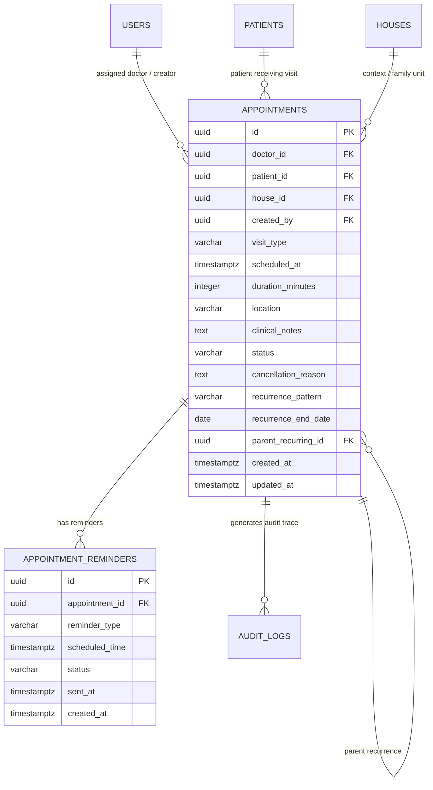
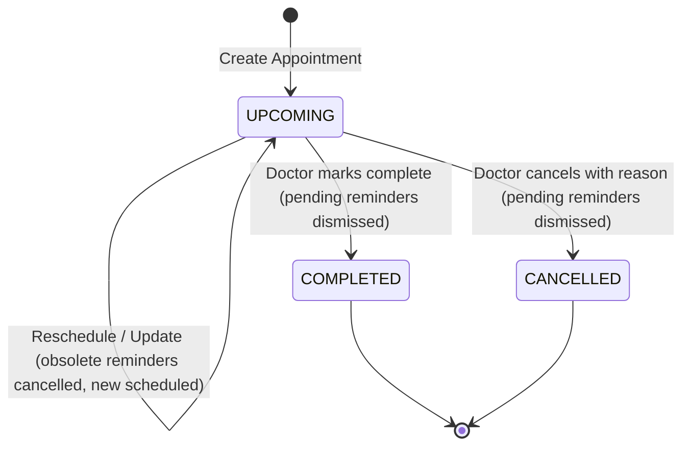

# Data Model: Manage Appointments and Follow-up Visits (UC.0)

**Feature**: `001-manage-appointments` | **Date**: 2026-10-23

## Entity-Relationship Diagram (ERD)



---

## 1. Table Definitions

### 1.1 `appointments` Table

| Column | Type | Constraints | Description |
|--------|------|-------------|-------------|
| `id` | `UUID` | `PRIMARY KEY, DEFAULT gen_random_uuid()` | Unique identifier |
| `doctor_id` | `UUID` | `NOT NULL, REFERENCES users(id) ON DELETE RESTRICT` | Assigned family physician |
| `patient_id` | `UUID` | `NOT NULL, REFERENCES patients(id) ON DELETE CASCADE` | Elderly patient |
| `house_id` | `UUID` | `NOT NULL, REFERENCES houses(id) ON DELETE CASCADE` | Family unit/house |
| `created_by` | `UUID` | `NOT NULL, REFERENCES users(id)` | User who scheduled the visit |
| `visit_type` | `VARCHAR(30)` | `NOT NULL, DEFAULT 'CLINIC'` | `CLINIC`, `HOME_VISIT`, `TELEHEALTH` |
| `scheduled_at` | `TIMESTAMPTZ` | `NOT NULL` | Scheduled start time in UTC |
| `duration_minutes` | `INTEGER` | `NOT NULL, DEFAULT 30` | Duration in minutes (15 - 240) |
| `location` | `VARCHAR(255)` | `NOT NULL` | Clinic address or home visit note |
| `clinical_notes` | `TEXT` | `NULLABLE` | Patient preparation/doctor guidelines |
| `status` | `VARCHAR(20)` | `NOT NULL, DEFAULT 'UPCOMING'` | `UPCOMING`, `COMPLETED`, `CANCELLED` |
| `cancellation_reason` | `TEXT` | `NULLABLE` | Reason string (required on cancellation) |
| `recurrence_pattern` | `VARCHAR(20)` | `NOT NULL, DEFAULT 'NONE'` | `NONE`, `WEEKLY`, `MONTHLY`, `QUARTERLY` |
| `recurrence_end_date` | `DATE` | `NULLABLE` | Optional end boundary for recurring visits |
| `parent_recurring_id` | `UUID` | `NULLABLE, REFERENCES appointments(id) ON DELETE SET NULL` | Links to root recurring appointment |
| `created_at` | `TIMESTAMPTZ` | `NOT NULL, DEFAULT NOW()` | Creation timestamp |
| `updated_at` | `TIMESTAMPTZ` | `NOT NULL, DEFAULT NOW()` | Last modification timestamp |

### Indexes:
- `idx_appointments_doctor_time`: `(doctor_id, scheduled_at)`
- `idx_appointments_patient_time`: `(patient_id, scheduled_at)`
- `idx_appointments_status_time`: `(status, scheduled_at)`
- `idx_appointments_house_id`: `(house_id)`
- `idx_appointments_parent_recurring`: `(parent_recurring_id)`

---

### 1.2 `appointment_reminders` Table

| Column | Type | Constraints | Description |
|--------|------|-------------|-------------|
| `id` | `UUID` | `PRIMARY KEY, DEFAULT gen_random_uuid()` | Unique reminder job ID |
| `appointment_id` | `UUID` | `NOT NULL, REFERENCES appointments(id) ON DELETE CASCADE` | Target appointment |
| `reminder_type` | `VARCHAR(20)` | `NOT NULL` | `BEFORE_24H` or `BEFORE_2H` |
| `scheduled_time` | `TIMESTAMPTZ` | `NOT NULL` | Calculated trigger time |
| `status` | `VARCHAR(20)` | `NOT NULL, DEFAULT 'PENDING'` | `PENDING`, `SENT`, `CANCELLED` |
| `sent_at` | `TIMESTAMPTZ` | `NULLABLE` | Actual dispatch timestamp |
| `created_at` | `TIMESTAMPTZ` | `NOT NULL, DEFAULT NOW()` | Job creation timestamp |

### Indexes:
- `idx_reminders_status_time`: `(status, scheduled_time)` (Optimized for worker polling)
- `idx_reminders_appointment_id`: `(appointment_id)`

---

## 2. State Transition Lifecycle



---

## 3. Pydantic Schemas

```python
class VisitTypeEnum(str, Enum):
    CLINIC = "CLINIC"
    HOME_VISIT = "HOME_VISIT"
    TELEHEALTH = "TELEHEALTH"

class AppointmentStatusEnum(str, Enum):
    UPCOMING = "UPCOMING"
    COMPLETED = "COMPLETED"
    CANCELLED = "CANCELLED"

class RecurrencePatternEnum(str, Enum):
    NONE = "NONE"
    WEEKLY = "WEEKLY"
    MONTHLY = "MONTHLY"
    QUARTERLY = "QUARTERLY"

class AppointmentCreate(BaseModel):
    patient_id: UUID
    scheduled_at: datetime
    duration_minutes: int = 30
    visit_type: VisitTypeEnum = VisitTypeEnum.HOME_VISIT
    location: str
    clinical_notes: Optional[str] = None
    recurrence_pattern: RecurrencePatternEnum = RecurrencePatternEnum.NONE
    recurrence_occurrences: Optional[int] = Field(default=1, ge=1, le=12)

class AppointmentUpdate(BaseModel):
    scheduled_at: Optional[datetime] = None
    duration_minutes: Optional[int] = None
    visit_type: Optional[VisitTypeEnum] = None
    location: Optional[str] = None
    clinical_notes: Optional[str] = None

class AppointmentCancelRequest(BaseModel):
    cancellation_reason: str = Field(..., min_length=3, max_length=500)

class AppointmentResponse(BaseModel):
    id: UUID
    doctor_id: UUID
    doctor_name: str
    patient_id: UUID
    patient_name: str
    house_id: UUID
    visit_type: VisitTypeEnum
    scheduled_at: datetime
    duration_minutes: int
    location: str
    clinical_notes: Optional[str]
    status: AppointmentStatusEnum
    cancellation_reason: Optional[str]
    recurrence_pattern: RecurrencePatternEnum
    parent_recurring_id: Optional[UUID]
    created_at: datetime
    updated_at: datetime

    class Config:
        from_attributes = True

---

## 4. Mobile Form State & Payload Mapping

```typescript
export interface AppointmentFormModalState {
  patientId: string; // Bound to selected patient's UUID
  patientName: string; // Display name
  selectedDate: string; // 'YYYY-MM-DD'
  selectedTime: string; // 'HH:mm'
  examType: string; // Clinical purpose
  visitType: 'HOME_VISIT' | 'CLINIC' | 'TELEHEALTH';
  location: string; // Clinic or home address
  instructions: string; // Guidelines for family
  enableSpeaker: boolean; // Sync to edge buzzer/speaker
  recurrencePattern: 'NONE' | 'WEEKLY' | 'MONTHLY' | 'QUARTERLY';
  recurrenceOccurrences: number; // 1 - 12
}

// Transformation to Backend Payload:
export function toAppointmentCreatePayload(state: AppointmentFormModalState): AppointmentCreateData {
  const [year, month, day] = state.selectedDate.split('-').map(Number);
  const [hour, minute] = state.selectedTime.split(':').map(Number);
  const scheduledIso = new Date(year, month - 1, day, hour, minute).toISOString();

  return {
    patient_id: state.patientId,
    patient_name: state.patientName,
    scheduled_at: scheduledIso,
    duration_minutes: 30,
    visit_type: state.visitType,
    location: state.location,
    clinical_notes: state.instructions ? `[${state.examType}] ${state.instructions}` : state.examType,
    enable_speaker_reminder: state.enableSpeaker,
    recurrence_pattern: state.recurrencePattern,
    recurrence_occurrences: state.recurrencePattern !== 'NONE' ? state.recurrenceOccurrences : 1,
  };
}
```

```
